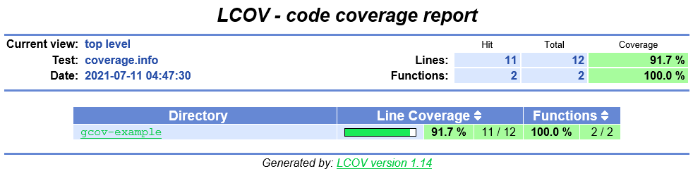
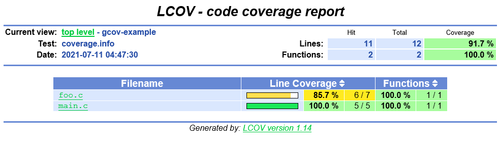
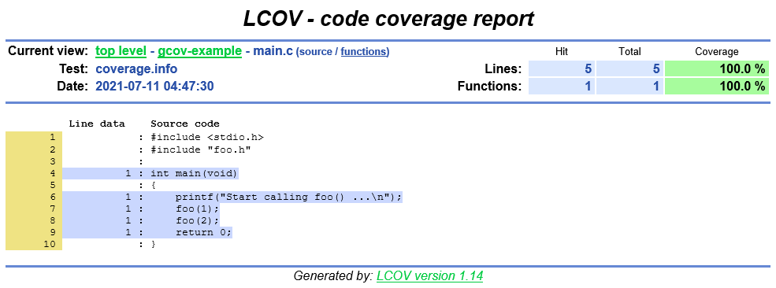
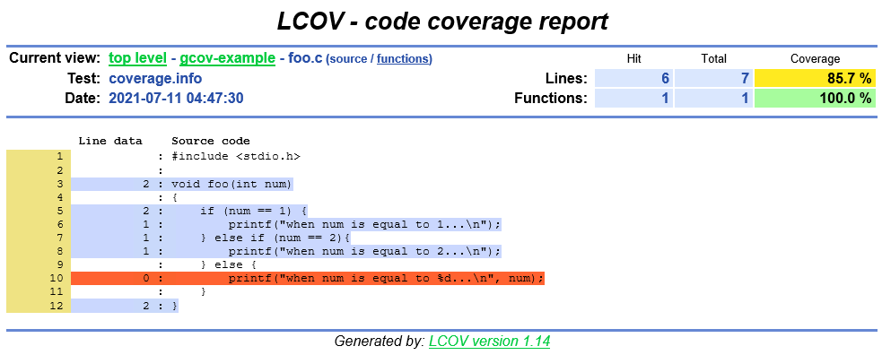

本篇分享如何使用 Gcov 和 LCOV 对 C/C++ 项目进行代码覆盖率的度量。

如果你想了解代码覆盖率工具 Gcov 是如何工作的，或是以后需要做 C/C++ 项目的代码覆盖率，希望本篇对你有所帮助。

> 2026 年 10 月更新：这篇文章写于 2021 年，当时的环境是 GCC 4.8.5 和 LCOV 1.14，示例仓库后来也改过几轮。这次把环境、命令和输出全部换成了 [gcov-example](https://github.com/shenxianpeng/gcov-example) 仓库 `master` 分支的当前状态，纠正了一处我原来对 `.gcov` 文件的错误理解，并补上了几条在遗留项目上真正会踩的坑。

## 问题

不知道你没有遇到过和我一样的问题：几十年前的 C/C++ 项目没有单元测试，只有回归测试，但是想知道回归测试测了哪些代码？还有哪些代码没测到？代码覆盖率是多少？今后哪些地方需要提高自动化测试用例？

可能对于接触过 Java 的 Junit 和 JaCoCo 的人来说，没有单元测试应该测不了代码覆盖率吧 ... 其实不然，如果不行就没有下文了 :)

## 现状

市场上有一些工具可以针对黑盒测试来衡量代码覆盖率 Squish Coco，Bullseye 等，它们的原理就是在编译的时候插入 instrumentation，中文叫插桩，在运行测试的时候用来跟踪和记录运行结果。

其中我比较深入的了解过 [Squish Coco](/zh-cn/posts/2019/squishcoco/) 它如何使用，但对于大型项目，引入这类工具都或多或少的需要解决编译上的问题。也正是因为有一些编译问题没有解决，就一直没有购买这款价格不菲的工具 License。

当我再次重新调查代码覆盖率的时候，我很惭愧的发现原来正在使用的 GCC 其实有内置的代码覆盖率的工具的，叫 [Gcov](https://gcc.gnu.org/onlinedocs/gcc/Gcov.html)

## 前提条件

对于想使用 Gcov 的人，为了说明它是如何工作的，我准备了一段示例程序，运行这个程序之前需要先安装 [GCC](https://gcc.gnu.org/install/index.html)、[LCOV](https://github.com/linux-test-project/lcov) 和 [gcovr](https://github.com/gcovr/gcovr)。在 Debian/Ubuntu 上，仓库里的 `make deps` 会把依赖装齐（lcov 用 apt 装，gcovr 用 pipx 装）。

如果没有环境或不想安装，可以直接查看示例仓库的 GitHub 仓库：https://github.com/shenxianpeng/gcov-example

注：主分支 `master` 下面放的是源码，CI 每次构建完会把生成的报告推到 `coverage` 分支，线上可以直接看 [LCOV 报告](https://shenxianpeng.dev/gcov-example/lcov-report/index.html) 和 [gcovr 报告](https://shenxianpeng.dev/gcov-example/gcovr-report/coverage.html)。

```bash
# 这是本文使用的环境，也是仓库 CI 的环境：Ubuntu 24.04
$ gcc --version
gcc (Ubuntu 13.3.0-6ubuntu2~24.04.1) 13.3.0

$ lcov --version
lcov: LCOV version 2.0-1

$ gcovr --version
gcovr 8.7
```

Ubuntu 24.04 自带的 lcov 是 2.0，写这篇更新时 lcov 的最新版本是 2.6，gcovr 是 8.7。如果你和我一样是从 lcov 1.x 过来的，2.x 有三处差别要留意：

* 2.x 会检查数据的一致性，发现问题默认按 ERROR 退出，而不是像 1.x 那样打一条 WARNING 继续跑。要绕过得明确写 `--ignore-errors <类型>`，后面的注意事项里有一个真实的例子；
* 2.x 依赖更多的 Perl 模块，从源码安装时要按它的 README 把模块装齐；
* 分支覆盖的开关改名为 `--rc branch_coverage=1`，1.x 的 `lcov_branch_coverage` 还能用，但已经标记为 deprecated。

## Gcov 是如何工作的

Gcov 工作流程图


主要分三步：

1. 在 GCC 编译的时加入特殊的编译选项，生成可执行文件，和 `*.gcno`；
2. 运行（测试）生成的可执行文件，生成了 `*.gcda` 数据文件；
3. 有了 `*.gcno` 和 `*.gcda`，lcov 或 gcovr 内部调用 `gcov` 读取它们，生成代码覆盖率报告；`gcov` 命令也可以单独运行，生成带逐行执行次数的 `.gcov` 文本文件。

下面就开始介绍其中每一步具体是怎么做的。

### 1. 编译

第一步编译，这里已经将编译用到的参数和文件都写在了 `makefile` 里了，只要执行 `make build` 就可以编译了（不带目标直接执行 `make` 只会打印帮助）。

```bash
make build
```

<details>
<summary>点击查看 make build 命令的输出</summary>

```bash
$ make build
gcc -fPIC -fprofile-arcs -ftest-coverage -c -Wall -Werror main.c -o main.o
gcc -fPIC -fprofile-arcs -ftest-coverage -c -Wall -Werror foo.c -o foo.o
gcc -fPIC -fprofile-arcs -ftest-coverage -c -Wall -Werror test.c -o test.o
gcc -fPIC -fprofile-arcs -ftest-coverage -c -Wall -Werror trigger.c -o trigger.o
gcc -fPIC -fprofile-arcs -ftest-coverage -o main main.o foo.o test.o trigger.o
```

</details>

通过输出可以看到，这个程序在编译的时候添加了两个编译选项 `-fprofile-arcs` 和 `-ftest-coverage`。现在更常见的写法是一个 `--coverage`，编译时它等价于这两个选项，链接时等价于 `-lgcov`。示例现在有 `main.c`、`foo.c`、`test.c`、`trigger.c` 四个源文件，`main` 依次调用 `foo(1)`、`foo(2)`、`test_zero()` 和 `trigger_action()`。在编译成功后，不仅生成了 `main` 和 `.o` 文件，同时还生成了四个 `.gcno` 文件。

> `.gcno` 记录文件是在加入 GCC 编译选项 `-ftest-coverage` 后生成的，在编译过程中它包含用于重建基本块图和为块分配源行号的信息。

### 2. 运行可执行文件

在编译完成后，生成了 `main` 这个可执行文件，运行（测试）它：

```bash
./main
```

<details>
<summary>点击查看运行 main 时输出</summary>

```bash
$ ./main
Start calling foo() ...
when num is equal to 1...
when num is equal to 2...
test 0
TRIGGER is OFF: running default logic...
```

</details>

当运行 `main` 后，执行结果被记录在了 `.gcda` 这个数据文件里，查看当前目录下可以看到一共生成了四个 `.gcda` 文件，每个源文件都对应一个 `.gcda` 文件。

```bash
$ ls
LICENSE  README.md  foo.c  foo.gcda  foo.gcno  foo.h  foo.o  img  main  main.c  main.gcda  main.gcno  main.o  makefile  test.c  test.gcda  test.gcno  test.h  test.o  trigger.c  trigger.gcda  trigger.gcno  trigger.h  trigger.o
```

> `.gcda` 记录数据文件的生成是因为程序在编译的时候引入了 `-fprofile-arcs` 选项。它包含弧过渡计数、值分布计数和一些摘要信息。

对于只有回归测试的项目，关于 `.gcda` 有两件事比命令本身更重要：

* **`.gcda` 只在进程正常退出时写出。** libgcov 是在退出阶段的析构函数里把计数写进 `.gcda` 的，进程被 `kill -9`、崩溃或者调用 `_exit()` 退出都不会写。我试了一下：用 `_exit(0)` 退出的程序跑完目录里没有 `.gcda`，先调 `__gcov_dump()` 再 `_exit(0)` 就有了。长驻的服务进程要在合适的时机自己调用 `__gcov_dump()`（配合 `__gcov_reset()` 可以清零重新计），否则一整套回归测试跑完什么都没留下。
* **计数是累加的。** 同一个可执行文件跑多次，`.gcda` 里的计数会累加而不是覆盖，`main` 跑两遍后 `main.c.gcov` 里 `foo(1);` 那一行的计数就是 2。这正好适合回归测试：跑完整套用例之后再采集一次，就是总的覆盖率。反过来，想重新计数就先把 `.gcda` 删掉。

### 3. 生成报告

```bash
make lcov-report    # 生成 lcov-report/index.html
# 或者
make gcovr-report   # 生成 gcovr-report/coverage.html
```

<details>
<summary> 点击查看 make lcov-report 的输出 </summary>

```bash
$ make lcov-report
gcov main.c foo.c test.c trigger.c
File 'main.c'
Lines executed:100.00% of 7
Creating 'main.c.gcov'

File 'foo.c'
Lines executed:85.71% of 7
Creating 'foo.c.gcov'

File 'test.c'
Lines executed:100.00% of 1
Creating 'test.c.gcov'

File 'trigger.c'
Lines executed:100.00% of 3
Creating 'trigger.c.gcov'

Lines executed:94.44% of 18
mkdir -p lcov-report
lcov --capture --directory . --no-recursion --output-file lcov-report/coverage.info
Capturing coverage data from .
geninfo cmd: '/usr/bin/geninfo . --output-filename lcov-report/coverage.info --no-recursion --memory 0'
Found gcov version: 13.3.0
Using intermediate gcov format
Writing temporary data to /tmp/geninfo_datErwK
Scanning . for .gcda files ...
Found 4 data files in .
Processing ./foo.gcda
Processing ./test.gcda
Processing ./trigger.gcda
Processing ./main.gcda
Finished .info-file creation
genhtml lcov-report/coverage.info --output-directory lcov-report
Found 4 entries.
Found common filename prefix "/"
Generating output.
Processing file /work/test.c
  lines=1 hit=1 functions=1 hit=1
Processing file /work/trigger.c
  lines=3 hit=3 functions=1 hit=1
Processing file /work/foo.c
  lines=7 hit=6 functions=1 hit=1
Processing file /work/main.c
  lines=7 hit=7 functions=1 hit=1
Overall coverage rate:
  lines......: 94.4% (17 of 18 lines)
  functions......: 100.0% (4 of 4 functions)
```

</details>

执行 `make lcov-report` 来生成 HTML 报告，这条命令的背后实际上主要执行了以下两个步骤：

1. 执行 `gcov main.c foo.c test.c trigger.c`，为每个源文件生成一份 `.gcov` 文本文件，里面是逐行的执行次数。

2. 执行 `lcov --capture` 从 `.gcno` 和 `.gcda` 收集数据生成 `coverage.info`，再用 `genhtml` 把它变成 HTML 报告。

这里要纠正一下本文最初的说法。我原来写的是"有了 `.gcov` 文件再通过 LCOV 生成报告"，这是错的：第 2 步并不读第 1 步生成的 `.gcov` 文件。lcov 的 geninfo 会自己在临时目录里调用 `gcov` 读取 `.gcno` 和 `.gcda`（新版本走的是 JSON 中间格式，也就是输出里那行 "Using intermediate gcov format"），gcovr 也是一样。把 `.gcov` 文件全删掉再跑 `lcov --capture`，报告照样能出来。单独运行 `gcov` 只是为了用肉眼看逐行标注，比如 `foo.c.gcov`：

```text
        -:    0:Source:foo.c
        -:    1:#include <stdio.h>
        -:    2:
        2:    3:void foo(int num) {
        2:    4:  if (num == 1) {
        1:    5:    printf("when num is equal to 1...\n");
        1:    6:  } else if (num == 2) {
        1:    7:    printf("when num is equal to 2...\n");
        -:    8:  } else {
    #####:    9:    printf("when num is equal to %d...\n", num);
        -:   10:  }
        2:   11:}
```

第一列是执行次数，`#####` 就是没有执行到的行，`-` 是没有可执行代码的行。

生成 HTML 结果报告的步骤如下：

```bash
# 1. 生成 coverage.info 数据文件
#    --no-recursion 是为了不把后面多配置演示在 build/ 目录下产生的数据混进来
lcov --capture --directory . --no-recursion --output-file lcov-report/coverage.info
# 2. 根据这个数据文件生成报告
genhtml lcov-report/coverage.info --output-directory lcov-report
```

换成 gcovr 的话一条命令就够了，它自己会去调用 `gcov`：

```bash
gcovr --root . --exclude-directories build --html --html-details --output gcovr-report/coverage.html
```

### 删除所有生成的文件

上面过程中所有生成的文件可通过执行 `make clean` 命令来彻底删除掉。

<details>
<summary> 点击查看 make clean 命令的输出 </summary>

```bash
$ make clean
rm -rf main *.out *.o *.so *.gcno *.gcda *.gcov build \
      lcov-report gcovr-report merged-report trigger-report
```
</details>

## 代码覆盖率报告

下面的截图是 2021 年 LCOV 1.14 的界面，当时示例只有 `main.c` 和 `foo.c` 两个文件。最新的报告看线上链接：[LCOV 报告](https://shenxianpeng.dev/gcov-example/lcov-report/index.html)。



首页以目录结构显示



进入目录后，显示该目录下的源文件



蓝色表示这些语句被覆盖



红色表示没有被覆盖的语句

> LCOV 支持语句、函数和分支覆盖度量。

旁注：

* 还有另外一个生成 HTML 报告的工具叫 [gcovr](https://github.com/gcovr/gcovr)，使用 Python 开发的，上面 `make gcovr-report` 生成的就是它的报告。这篇文章最初写的时候 gcovr 只能按文件路径平铺显示，LCOV 按目录结构显示，后者与代码结构一致，所以我当时更倾向于 LCOV。gcovr 从 6.0 起有了 `--html-nested` 的目录层级报告，8.7 又把默认主题换成了 GitHub 风格，现在两者都能做目录层级，选哪个看团队习惯。仓库同时提供两种报告：[LCOV 报告](https://shenxianpeng.dev/gcov-example/lcov-report/index.html)、[gcovr 报告](https://shenxianpeng.dev/gcov-example/gcovr-report/coverage.html)。

## 进阶：合并多个构建配置的覆盖率

真实项目里，同一份源码经常会用不同的宏编译出不同的配置（功能开关、平台差异）。单个构建只能看到自己编译进去的那部分代码，另一个分支根本没被编译，报告里自然也不会出现，这时候 100% 的数字是骗人的。

仓库里的 `trigger.c` 就是这样一个例子，`#ifdef TRIGGER_ON` / `#else` 两个分支各打印一句话：

```c
void trigger_action(void) {
#ifdef TRIGGER_ON
  printf("TRIGGER is ON: running extra logic...\n");
#else
  printf("TRIGGER is OFF: running default logic...\n");
#endif
}
```

`make coverage-merged` 会把两个配置分别构建到 `build/config1`（加 `-DTRIGGER_ON`）和 `build/config2`（默认），各跑一遍，然后用 `lcov --add-tracefile` 把两份 `.info` 合并成一份报告：

```bash
lcov --capture --directory build/config1 --output-file build/config1.info
lcov --capture --directory build/config2 --output-file build/config2.info
lcov --add-tracefile build/config1.info --add-tracefile build/config2.info --output-file build/merged.info
genhtml build/merged.info --output-directory merged-report
```

| 构建 | `trigger.c` 命中行数 |
|---|---|
| `build/config1`（`-DTRIGGER_ON`） | 3 of 3 |
| `build/config2`（默认） | 3 of 3 |
| 合并后 | 4 of 4 |

两个配置单独看都是 100%，只有合并后的报告才同时看到两个分支。

每个配置必须用独立的目录。GCC 会把编译时间戳写进 `.gcno`，两个配置共用一个目录的话，第二次编译会覆盖 `.gcno`，第一个二进制写出的 `.gcda` 就对不上了，gcov 报 `stamp mismatch with notes file`，lcov 2.x 直接 `ERROR: GCOV failed` 退出。

只想看单个文件的覆盖率，可以用 `lcov --extract` 从完整的 `.info` 里抽出来，仓库里的 `make coverage-filter` 演示的就是只看 `trigger.c`。线上页面：[合并报告](https://shenxianpeng.dev/gcov-example/merged-report/index.html)、[trigger.c 单文件报告](https://shenxianpeng.dev/gcov-example/trigger-report/index.html)。

## 注意事项

回到开头的场景：遗留项目，只有黑盒回归测试。真要把 Gcov 用到这种项目上，除了前面说的 `.gcda` 写出时机，还有几点当年没写、在这种项目上最容易踩的坑。

* **覆盖率构建用 `-O0 -g`。** 优化会把行合并或者删掉，行覆盖就失真了。同一个 `foo.c`，`-O0` 下 gcov 报 `Lines executed:85.71% of 7`，加上 `-O2` 变成 `100.00% of 4`，那条没测到的 `else` 分支直接从报告里消失了。
* **测试机和构建机不是同一台时，用 `GCOV_PREFIX` 和 `GCOV_PREFIX_STRIP`。** `.gcda` 的写入路径是编译时写死的绝对路径，测试机上没有这个目录就写不出来。比如构建时的目标文件是 `/user/build/foo.o`，在测试机上设置 `GCOV_PREFIX=/target/run` 和 `GCOV_PREFIX_STRIP=1`，运行时就会写到 `/target/run/build/foo.gcda`，之后再把 `.gcda` 拷回构建机生成报告。详见 GCC 文档的 [Cross-profiling](https://gcc.gnu.org/onlinedocs/gcc/Cross-profiling.html)。
* **`gcov` 必须和编译用的 `gcc` 是同一个版本。** 用 gcc-12 编译、用 gcov 13 去读，gcov 会抱怨 `main.gcno:version 'B24*', prefer 'B33*'`，lcov 2.x 则直接报错：

  ```text
  geninfo: ERROR: Incompatible GCC/GCOV version found while processing /work/foo.gcda:
      Your test was built with 'B24*'.
      You are trying to capture with gcov tool '/usr/bin/gcov' which is version 'B33*'.
      (use "geninfo --ignore-errors version ..." to bypass this error)
  ```

  别急着加 `--ignore-errors`，用 `--gcov-tool gcov-12` 指定配套的 gcov 就好。
* **macOS 上的 `gcc` 其实是 Apple clang。** 它的 `gcov` 是 `llvm-cov gcov`，`--coverage` 编译、`./main`、`gcov main.c` 这几步照样能跑，但 lcov 2.x 要写成 `--gcov-tool llvm-cov --gcov-tool gcov` 才认得（1.x 要靠一个包装脚本）。另外 clang 和 GCC 对"行"的统计不完全一样：同一个 `foo.c`，GCC 13 报 `85.71% of 7`，Apple clang 21 报 `87.50% of 8`。比较覆盖率数字时别跨编译器比。

## 相关阅读

* [关于代码覆盖率（About Code Coverage）](/zh-cn/posts/2021/code-coverage/)
* 在 Linux 内核中使用 Gcov 的示例：https://docs.kernel.org/dev-tools/gcov.html
* 当构建环境与测试环境不同时设置环境变量：https://gcc.gnu.org/onlinedocs/gcc/Cross-profiling.html
* 覆盖率之外，C/C++ 项目在 CI 里做格式和静态检查可以看 [cpp-linter-action](https://github.com/cpp-linter/cpp-linter-action)，gcov-example 仓库自己的 PR 检查用的就是它。
