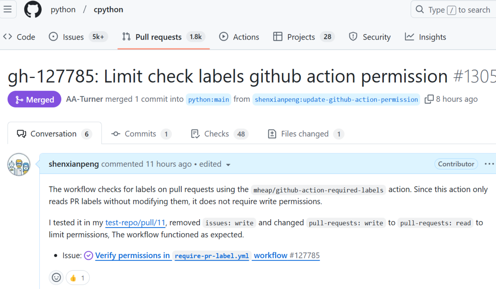

Last night, by the time I had put my daughter to sleep, it was already midnight. I went back to my room, opened GitHub, and looked for something I could contribute to.

This time I went to CPython's issue tracker.

I had wanted to contribute to CPython for a long time but never took the first step. Part of the push came from watching Tian Gao ([@gaogaotiantian](https://github.com/gaogaotiantian)), a CPython core developer who works on `pdb`. This time I decided to look for a way in through the area I know best.

So I filtered the issues down to infrastructure and CI, and soon found one that fit.

## The issue

[gh-127785](https://github.com/python/cpython/issues/127785) asked a narrow question. CPython's `require-pr-label.yml` workflow checks that pull requests carry the right labels, and its jobs requested `issues: write` and `pull-requests: write`. Did they actually need write access? Ezio Melotti had opened it in December 2024 after the question came up in a review, and nobody had picked it up yet.

The workflow does its check with [mheap/github-action-required-labels](https://github.com/mheap/github-action-required-labels), which only reads a pull request's labels and never changes them. Read access should be enough.

## The change

Before touching CPython, I reproduced the workflow in a [test repository](https://github.com/shenxianpeng/test-repo/pull/11), removed `issues: write`, and lowered `pull-requests` to `read`. The label check still worked.

The pull request itself, [#130596](https://github.com/python/cpython/pull/130596), is the same edit in both jobs of the workflow:

```diff
     permissions:
-      issues: write
-      pull-requests: write
+      pull-requests: read
```

It is a small diff, but it is the kind that matters in a repository like CPython. If a third-party action in that job is ever compromised, the token it receives can read pull requests and very little else.

I opened the pull request and went to bed.

**When I woke up, it had been merged into CPython's main branch.**



Adam Turner approved and merged it about three hours after I opened it.

## The backports

CPython's bot then tried to backport the change to the 3.13 and 3.12 branches and failed on both with merge conflicts. Hugo van Kemenade asked me to take care of the backports, so I did them by hand, cherry-picking the commit onto each branch: [#130623](https://github.com/python/cpython/pull/130623) for 3.13 and [#130625](https://github.com/python/cpython/pull/130625) for 3.12. Hugo merged both the next day.

It was my first look at how CPython carries a change across its maintenance branches, and at what a contributor is expected to do when the automation gives up.

## What I took away

It is not a big achievement. It was a good way to learn, though. Taking part in a project this well run shows you how it manages issues and pull requests (labels, bots, backport branches) and what it does well, and some of that carries over into my own work and projects.

Contributing to projects like this also builds skills, and it puts you in conversation with very good developers.

In the short term it may bring nothing tangible. If it is something you genuinely enjoy, the long-term investment is worth it.

---

**Postscript, 2026:** A second pull request followed. [gh-140682](https://github.com/python/cpython/pull/140682) pins the hooks in CPython's pre-commit configuration to commit hashes and updates the links to zizmor, the GitHub Actions security linter CPython runs in CI. Same theme, the supply chain of CPython's own CI. That one took four months to land, from October 2025 to March 2026, which is probably the more typical pace for a project this size.
