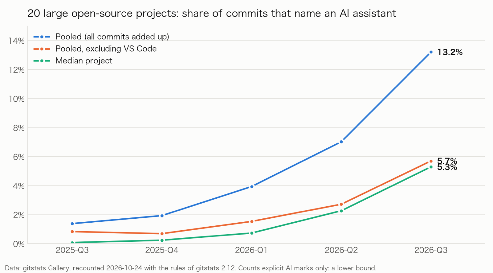
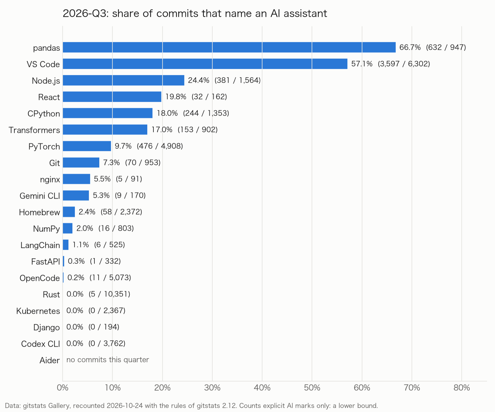
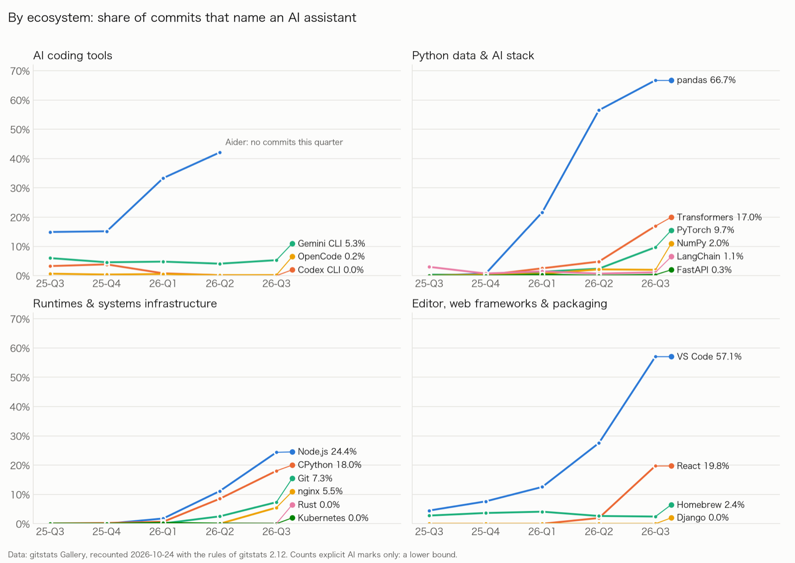
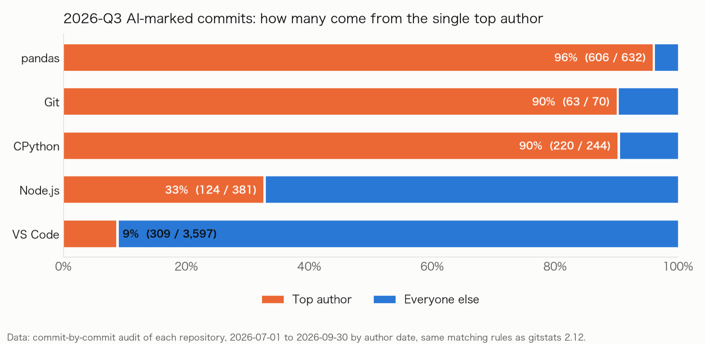

> Data through 2026-09-30 · recounted 2026-10-24 with the rules of gitstats 2.12 · by shenxianpeng (gitstats)

## The short version

**In 2026 Q3, 13.2% of the commits in 20 large open-source projects named an AI coding assistant, up from 1.4% a year earlier. The growth is concentrated: VS Code alone made 63% of those commits. Without VS Code the share is 5.7%, and the median project is at 5.3%.**

The other end of the table hasn't moved: Rust, Kubernetes and Django are still close to zero.



## What this index counts

The [gitstats](https://github.com/shenxianpeng/gitstats) [Gallery](https://shenxianpeng.dev/gitstats/gallery/) rebuilds a report from the full git history of 20 large open-source projects every week. One of the things it counts is commits that name an AI assistant. A commit counts if any of these is true:

- its author is an AI account (for example `copilot-swe-agent[bot]`);
- a `Co-authored-by:` trailer points at an AI address (for example `noreply@anthropic.com`);
- it carries a line a tool signs with (for example `Generated with [Claude Code]`);
- a disclosure trailer such as `Assisted-by:` or `Generated-by:` names an assistant.

**This counts marks, not how much code AI wrote.** A mark says an assistant took part in the commit. It doesn't say whether it wrote one line or all of them. AI use that leaves no mark (inline completion, tools with the trailer turned off) isn't counted at all. Every number here is a **lower bound**.

## Key numbers

| Measure | 2025 Q3 | 2026 Q2 | 2026 Q3 |
|---|---:|---:|---:|
| Pooled share (all 20 projects' commits added up) | 1.4% (421 / 30,492) | 7.0% (2,708 / 38,573) | **13.2% (5,696 / 43,131)** |
| Pooled share without VS Code | 0.8% (216 / 25,922) | 2.7% (866 / 31,880) | **5.7% (2,099 / 36,829)** |
| Median project | 0.1% | 2.3% | **5.3%** |
| Projects at 5% or more | 2 of 20 | 5 of 20 | **10 of 19** |
| VS Code's part of all AI-marked commits | 48.7% | 68.0% | **63.1%** |

Only 19 projects count in 2026 Q3: Aider made no commits this quarter.

### By project

| Project | 2025 Q3 | 2025 Q4 | 2026 Q1 | 2026 Q2 | 2026 Q3 | 2026 Q3 marked / all | Most-named assistant (all time) |
|---|---:|---:|---:|---:|---:|---:|---|
| pandas | 0.0% | 0.7% | 21.7% | 56.5% | **66.7%** | 632 / 947 | Claude |
| VS Code | 4.5% | 7.6% | 12.6% | 27.5% | **57.1%** | 3,597 / 6,302 | GitHub Copilot |
| Node.js | 0.0% | 0.0% | 1.8% | 11.1% | **24.4%** | 381 / 1,564 | Codex |
| React | 0.0% | 0.0% | 0.0% | 1.9% | **19.8%** | 32 / 162 | Claude |
| CPython | 0.1% | 0.3% | 0.7% | 8.5% | **18.0%** | 244 / 1,353 | Claude |
| Transformers | 0.3% | 0.2% | 2.5% | 4.8% | **17.0%** | 153 / 902 | Claude |
| PyTorch | 0.3% | 0.2% | 1.3% | 2.4% | **9.7%** | 476 / 4,908 | Claude |
| Git | 0.0% | 0.0% | 0.1% | 2.5% | **7.3%** | 70 / 953 | Claude |
| nginx | 0.0% | 0.0% | 0.0% | 0.0% | **5.5%** | 5 / 91 | OpenCode |
| Gemini CLI | 6.0% | 4.6% | 4.8% | 4.1% | **5.3%** | 9 / 170 | Gemini |
| Homebrew | 2.8% | 3.7% | 4.1% | 2.6% | **2.4%** | 58 / 2,372 | GitHub Copilot |
| NumPy | 0.0% | 0.4% | 0.7% | 2.2% | **2.0%** | 16 / 803 | Claude |
| LangChain | 3.0% | 0.7% | 1.5% | 0.7% | **1.1%** | 6 / 525 | GitHub Copilot |
| FastAPI | 0.0% | 0.0% | 0.4% | 0.0% | **0.3%** | 1 / 332 | — |
| OpenCode | 0.7% | 0.4% | 0.6% | 0.2% | **0.2%** | 11 / 5,073 | OpenCode |
| Rust | 0.0% | 0.0% | 0.0% | 0.1% | **0.0%** | 5 / 10,351 | Claude |
| Kubernetes | 0.0% | 0.0% | 0.3% | 0.0% | **0.0%** | 0 / 2,367 | Claude |
| Django | 0.0% | 0.0% | 0.0% | 0.0% | **0.0%** | 0 / 194 | — |
| Codex CLI | 3.3% | 3.8% | 0.8% | 0.2% | **0.0%** | 0 / 3,762 | Codex |
| Aider | 14.9% | 15.2% | 33.3% | 42.1% | **no commits** | 0 / 0 | Aider |

"Most-named assistant" comes from the data's `all_time.assistants`, over each project's whole history, not just this quarter. FastAPI has 3 marked commits in all, one each for Claude, Cursor and Copilot.



## By ecosystem



### The AI coding tools themselves: the lowest numbers, and falling

You'd expect the teams building AI coding tools to use them the most. Their histories name an assistant the least:

- **Codex CLI fell from 3.8% to 0%**, and that's not because the team stopped using AI. Since 2026-07-10 the public repository's commits are exported from an internal OpenAI repository (the committer is `copyberry` and every commit ends in `GitOrigin-RevId`). The marks in the original messages don't survive the export. The pipeline changed, not the behaviour.
- **Aider didn't "drop to 0%".** It has had no commits since 2026-05-22. Its earlier high share came from Aider writing itself in as a commit's author.
- **OpenCode at 0.2%**: gitstats deliberately doesn't count the accounts OpenCode releases and regenerates files under as an assistant. What's left has few explicit marks.
- **Gemini CLI** holds at 4–6%, while its quarterly commits fell from 1,878 to 170 (we didn't look into why).

How a tool team commits, and how it syncs its public repository, decides these numbers more than whether the team uses AI.

### The Python data and AI stack: the fastest growth, but look at who commits

- **pandas, at 66.7%,** tops the table. The audit found that **606 of its 632 marked commits come from one long-time core maintainer**: nearly every one of their 625 commits this quarter carries `Co-authored-by: Claude …`. **Without them, the rest of the contributors are at 8.1%.** Since 2026-01 pandas has required contributors to disclose AI use, naming the tool, the model and its version.
- **Transformers (17.0%) and PyTorch (9.7%)** both jumped in 2026 Q3 (from 4.8% and 2.4%). We didn't audit them commit by commit. PyTorch's AI policy (2026-07) asks for disclosure in the pull request, not the commit.
- **NumPy (2.0%), LangChain (1.1%) and FastAPI (0.3%)** have stayed low.

### Language runtimes and systems infrastructure: two extremes

- **Node.js, 24.4%**: almost all marks are `Assisted-by:` disclosures (`Codex`, `OpenCode`, `Claude` and others), from 40 authors; the top three made 77% of them. Node.js published an AI use policy on 2026-08-12, and marked commits rose clearly in the two months after. The same policy **recommends leaving commercial brand names out of commit messages**, writing "a closed-source coding agent" instead: gitstats counts those commits under an unnamed assistant, 11 of them this quarter. Disclosures made only in the pull request still aren't counted, so Node.js's number remains a lower bound.
- **CPython, 18.0%**: **220 of 244 come from one core developer**. Without them it's 2.4%. CPython's guidance says disclosing AI use in the pull request is appreciated but not required.
- **Git, 7.3%**: marks only appeared in 2026, and **63 of the 70 come from one maintainer**, mostly disclosures that name a model alone, such as `Assisted-by: Opus 4.7`. Without them it's 0.8%.
- **nginx, 5.5%**: 91 commits this quarter, 5 of them marked: a small sample.
- **Rust (≈0%) and Kubernetes (0%)**: Rust adopted an LLM policy in 2026-08. LLMs may be used to analyse, check and review, but not to create; LLM-written code is allowed only under experiment rules. Part of Rust's zero is a **restriction**, not just a missing mark.

### Editor, web frameworks and packaging

- **VS Code, 57.1%**: unlike pandas, this is **broad**. 3,597 marked commits come from 129 authors, and the top five make only 32% of them. A year ago its marks were mostly the Copilot agent committing as the author; now they are mostly people's commits with `Co-authored-by: Copilot`. Two things to keep in mind: VS Code and Copilot both come from Microsoft, so this is a team using its own tools; and Copilot tooling can write that trailer automatically (VS Code has a `git.addAICoAuthor` setting that was on by default for a few weeks in 2026-04 and is off by default now).
- **React, 19.8%**: from 0 to 20% in a year, but on 162 commits this quarter, 32 marked.
- **Homebrew (2.4%)** is roughly flat. **Django (0%)** requires contributors to disclose AI use, but the disclosure doesn't reach the commit message (presumably it stays in the pull request or ticket).

## How concentrated the marks are



Two high shares can mean very different things:

| Project | 2026 Q3 share | Top author's part of marked commits | Share without that author |
|---|---:|---:|---:|
| pandas | 66.7% | 96% (606 / 632) | 8.1% (26 / 322) |
| CPython | 18.0% | 90% (220 / 244) | 2.4% (24 / 995) |
| Git | 7.3% | 90% (63 / 70) | 0.8% (7 / 868) |
| Node.js | 24.4% | 33% (124 / 381) | 18.9% (257 / 1,357) |
| VS Code | 57.1% | 9% (309 / 3,597) | 55.2% (3,288 / 5,953) |

(This table comes from auditing each repository commit by commit, by author date; its counts match the table above.)

So the index answers "where have AI marks **appeared**, and **how fast** are they growing" better than "which community relies on AI more".

## Method and limits

1. **Only explicit marks count, so this is a lower bound.** Inline completion leaves no trace; most tools let you turn the co-author trailer off; people remove it by hand; disclosures kept in the pull request never reach the commit. None of that is counted.
2. **A mark is not AI-written code.** `Co-authored-by: Claude` may mean the assistant wrote the whole change, or helped with one test. Every "share" in this report is the share of commits that name an AI assistant.
3. **Projects disclose differently, so their shares can't be compared directly.** This quarter we found:
   - **disclosure required and written into the commit**: pandas (tool and model named);
   - **disclosure required or encouraged, but anonymised or kept in the pull request**: Node.js (no brands in commits), PyTorch (in the PR), Django (required, but not in commits);
   - **appreciated, not required**: CPython;
   - **use restricted**: Rust (no LLM-created content; code only under experiment rules);
   - **no project-level rule found, but tools add the trailer automatically**: VS Code.

   A high share may mean heavy use or careful disclosure; a zero may mean no use, or disclosure somewhere else. **Changes within one project over time are more reliable than comparisons between projects.**
4. **A few people can set a project's number.** Over nine in ten of pandas', CPython's and Git's marked commits come from one core contributor each.
5. **Pipelines change the numbers.** When Codex CLI's public repository switched to an export from an internal one, its marks disappeared. Whether a squash merge keeps the PR description, or a bot rewrites commit messages, changes the result too.
6. **Small samples.** React (162 commits), nginx (91) and Gemini CLI (170) had few commits this quarter; a handful can move them several points.
7. **Project selection.** The 20 projects are the Gallery's fixed sample: large, well-known, English-speaking communities. They don't represent open source as a whole, and 4 of them are AI coding tools.
8. **Recounted.** The Gallery froze its snapshot of this quarter on 2026-10-15. gitstats 2.12 then learned marks it had missed: Claude named by model alone (such as `Opus 4.7`), Grok, IBM Bob, Pi, and disclosures that name no assistant, such as "a closed-source coding agent". This report recounts the 20 projects with those rules, as of 2026-10-24. Against the frozen snapshot, Node.js goes from 22.6% to 24.4% and Git from 5.1% to 7.3%; the pooled share stays at 13.2%. The recount also takes in commits merged after the quarter with an author date inside it.

## Reproduce it

**1. From the Gallery's data** (every pooled number in this report comes from these 20 projects of it):

```bash
curl -O https://shenxianpeng.dev/gitstats/gallery/ai.json
```

Each project's `quarters` in `ai.json` holds the quarterly numbers of the tables here: `ai_assisted` is the marked commits, `commits` all of them.

**2. Count any repository yourself:**

```bash
pipx install gitstats
```

```bash
git clone https://github.com/pandas-dev/pandas.git
```

```bash
gitstats pandas report-pandas
```

In `report-pandas/summary.json`, `ai_assisted.by_month` and `ai_assisted.commits_by_month` hold the marked and total commits for each month. Add up three months for a quarter.

**3. Read the matching rules:** what counts as an AI mark is all in [`gitstats/assistants.py`](https://github.com/shenxianpeng/gitstats/blob/main/gitstats/assistants.py). The commit-by-commit audits in this report use the same rules, listing each repository's marked commits by author and by mark, by author date.

## Data and citation

- This report's data: the 20 projects of `https://shenxianpeng.dev/gitstats/gallery/ai.json` (generated 2026-10-24T17:52:09Z by gitstats 2.12.0)
- Frozen snapshot (earlier rules): `https://shenxianpeng.dev/gitstats/gallery/ai/2026-Q3.json` (generated 2026-10-15T11:33:26Z)
- Pipeline: [`.github/workflows/gallery.yml`](https://github.com/shenxianpeng/gitstats/blob/main/.github/workflows/gallery.yml), every Monday
- Matching rules: [`gitstats/assistants.py`](https://github.com/shenxianpeng/gitstats/blob/main/gitstats/assistants.py)

Suggested citation (draft):

> Shen, Xianpeng. *Open-Source AI Coding Index, 2026 Q3.* gitstats Gallery, 2026. Data: https://shenxianpeng.dev/gitstats/gallery/ai.json (recounted 2026-10-24).
