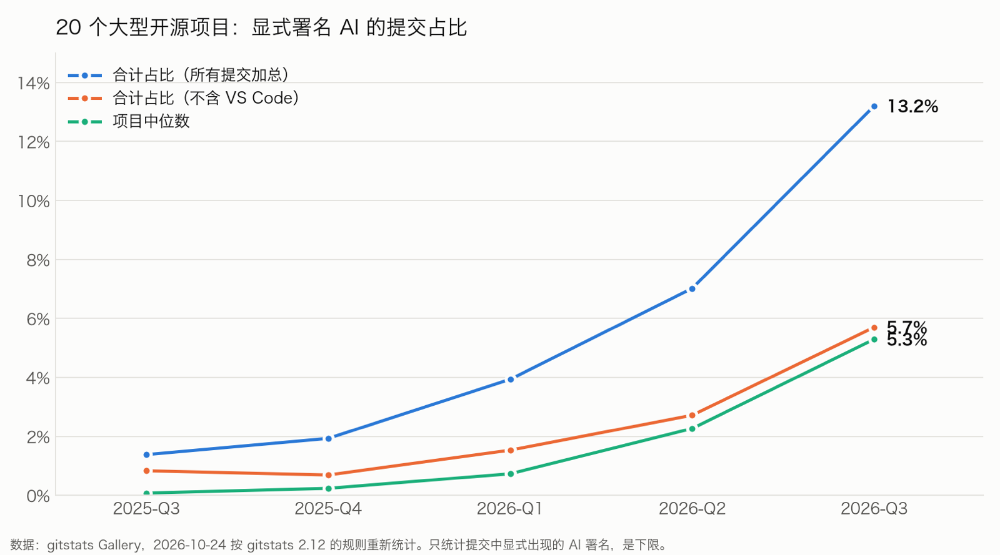
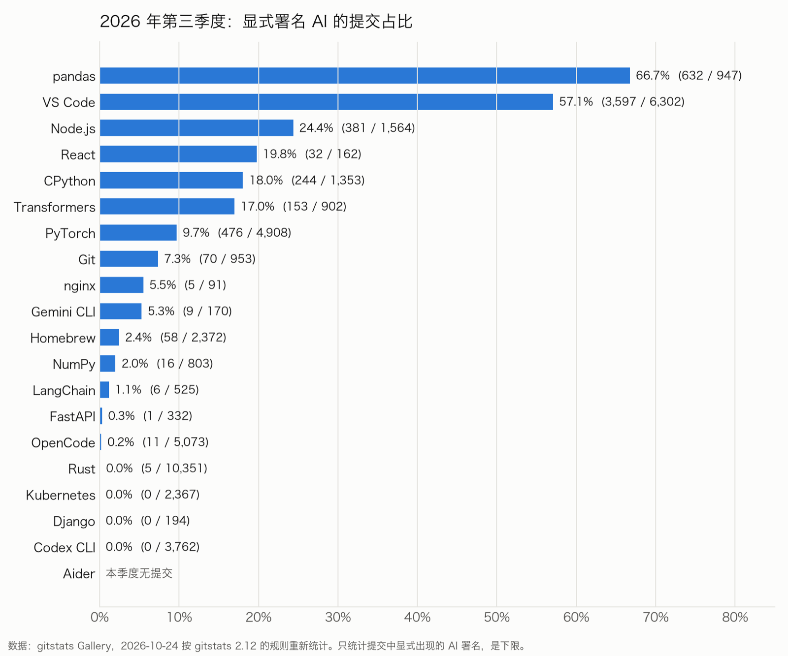
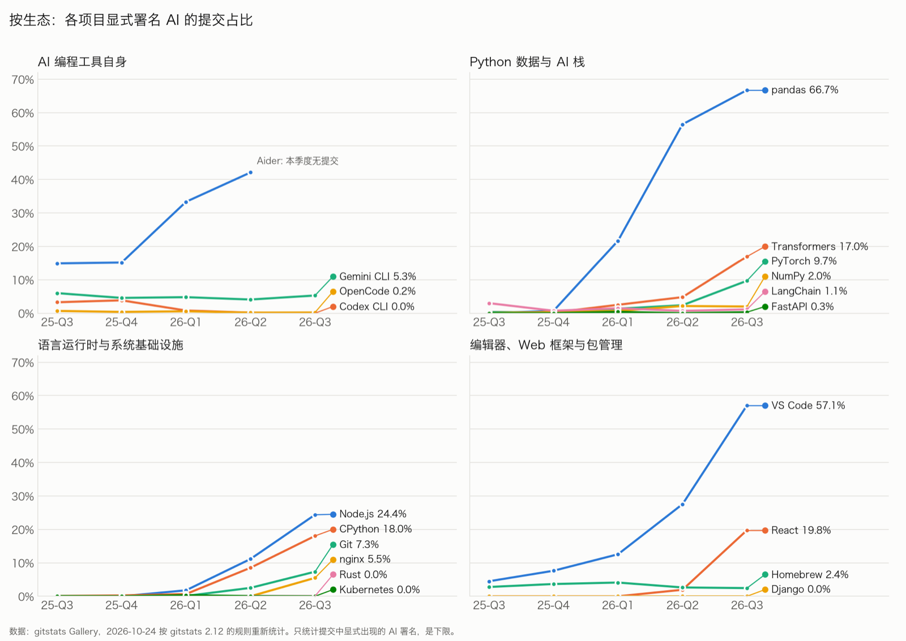
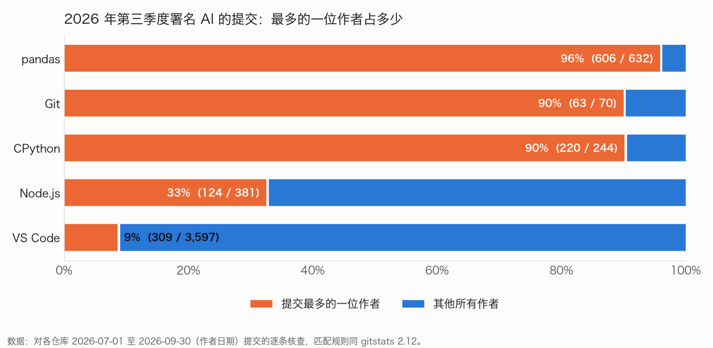

> 数据截至 2026-09-30 · 2026-10-24 按 gitstats 2.12 的统计规则重新统计

## 一句话结论

**2026 年第三季度，20 个大型开源项目里有 13.2% 的提交写明了 AI 参与，一年前是 1.4%。这个数字衡量的是署名习惯，AI 实际写了多少代码，它回答不了。**

写不写完全因人而异。pandas 一位核心维护者本季度 625 条提交里，606 条写了 `Co-authored-by: Claude`，约 97%；大多数贡献者一条都没写。没写的人用了多少 AI，从代码本身看不出来。所以 13.2% 是**下限**，很可能远低于实际用量。

增长也高度集中：VS Code 一家占了全部署名提交的 63%，不算 VS Code 是 5.7%，中位数项目是 5.3%。另一面，Rust、Kubernetes、Django 的署名提交仍然接近 0。



## 怎么算「署名」

[gitstats](https://github.com/shenxianpeng/gitstats) 的 [Gallery](https://shenxianpeng.dev/gitstats/gallery/) 每周对 20 个大型开源项目的完整 git 历史生成报告。其中一项是「署名 AI 的提交」：一条提交只要满足下面任一项就被计入：

- 作者就是 AI 账号（例如 `copilot-swe-agent[bot]`）；
- 有 `Co-authored-by:` 指向 AI 的地址（例如 `noreply@anthropic.com`）；
- 有工具留下的签名行（例如 `Generated with [Claude Code]`）；
- 有 `Assisted-by:` / `Generated-by:` 这类披露 trailer，并写出了助手名字。

**这里数的是「署名」。** 一个标记只说明 AI 参与了这条提交，说明不了它写了一行还是全部；而没留标记的 AI 使用（行内补全、关掉 trailer 的工具）完全数不到。所以每个数字都是**下限**。

## 关键数字

| 指标 | 2025-Q3 | 2026-Q2 | 2026-Q3 |
|---|---:|---:|---:|
| 合计占比 | 1.4%（421 / 30,492） | 7.0%（2,708 / 38,573） | **13.2%（5,696 / 43,131）** |
| 不含 VS Code | 0.8%（216 / 25,922） | 2.7%（866 / 31,880） | **5.7%（2,099 / 36,829）** |
| 项目中位数 | 0.1% | 2.3% | **5.3%** |
| ≥5% 的项目 | 2 / 20 | 5 / 20 | **10 / 19** |
| VS Code 占署名的比例 | 48.7% | 68.0% | **63.1%** |

「合计占比」把 20 个项目的提交加在一起算，大项目分量更重；「项目中位数」把每个项目当作一票。2026-Q3 只有 19 个项目参与统计：Aider 本季度没有任何提交。

### 各项目明细

| 项目 | 2025-Q3 | 2025-Q4 | 2026-Q1 | 2026-Q2 | 2026-Q3 | 2026-Q3 署名 / 总提交 | 累计最多的助手 |
|---|---:|---:|---:|---:|---:|---:|---|
| pandas | 0.0% | 0.7% | 21.7% | 56.5% | **66.7%** | 632 / 947 | Claude |
| VS Code | 4.5% | 7.6% | 12.6% | 27.5% | **57.1%** | 3,597 / 6,302 | GitHub Copilot |
| Node.js | 0.0% | 0.0% | 1.8% | 11.1% | **24.4%** | 381 / 1,564 | Codex |
| React | 0.0% | 0.0% | 0.0% | 1.9% | **19.8%** | 32 / 162 | Claude |
| CPython | 0.1% | 0.3% | 0.7% | 8.5% | **18.0%** | 244 / 1,353 | Claude |
| Transformers | 0.3% | 0.2% | 2.5% | 4.8% | **17.0%** | 153 / 902 | Claude |
| PyTorch | 0.3% | 0.2% | 1.3% | 2.4% | **9.7%** | 476 / 4,908 | Claude |
| Git | 0.0% | 0.0% | 0.1% | 2.5% | **7.3%** | 70 / 953 | Claude |
| nginx | 0.0% | 0.0% | 0.0% | 0.0% | **5.5%** | 5 / 91 | OpenCode |
| Gemini CLI | 6.0% | 4.6% | 4.8% | 4.1% | **5.3%** | 9 / 170 | Gemini |
| Homebrew | 2.8% | 3.7% | 4.1% | 2.6% | **2.4%** | 58 / 2,372 | GitHub Copilot |
| NumPy | 0.0% | 0.4% | 0.7% | 2.2% | **2.0%** | 16 / 803 | Claude |
| LangChain | 3.0% | 0.7% | 1.5% | 0.7% | **1.1%** | 6 / 525 | GitHub Copilot |
| FastAPI | 0.0% | 0.0% | 0.4% | 0.0% | **0.3%** | 1 / 332 | — |
| OpenCode | 0.7% | 0.4% | 0.6% | 0.2% | **0.2%** | 11 / 5,073 | OpenCode |
| Rust | 0.0% | 0.0% | 0.0% | 0.1% | **0.0%** | 5 / 10,351 | Claude |
| Kubernetes | 0.0% | 0.0% | 0.3% | 0.0% | **0.0%** | 0 / 2,367 | Claude |
| Django | 0.0% | 0.0% | 0.0% | 0.0% | **0.0%** | 0 / 194 | — |
| Codex CLI | 3.3% | 3.8% | 0.8% | 0.2% | **0.0%** | 0 / 3,762 | Codex |
| Aider | 14.9% | 15.2% | 33.3% | 42.1% | **无提交** | 0 / 0 | Aider |

「累计最多的助手」取自数据的 `all_time.assistants`，是项目历来的累计，不只是本季度。FastAPI 累计只有 3 条，Claude、Cursor、Copilot 各 1 条。



## 按生态看差异



### AI 编程工具自身：数字最低，而且在下降

直觉上，做 AI 编程工具的团队应该最爱用 AI。可他们的提交里署名反而最少：

- **Codex CLI 从 3.8% 降到 0%**，原因在数据管道。2026-07-10 起，公开仓库的提交改由 OpenAI 内部仓库导出（提交者是 `copyberry`，每条都带 `GitOrigin-RevId`），原始提交信息里的标记没有保留下来。
- **Aider 在 2026-05-22 之后就没有提交了**，所以本季度没有占比。之前的高占比来自 Aider 把自己写成提交作者。
- **OpenCode 0.2%**：gitstats 刻意不把 OpenCode 自己发版和重新生成文件的机器人账号算作 AI 助手，剩下的显式署名很少。
- **Gemini CLI** 稳定在 4–6%，但季度提交量从 1,878 降到 170（原因这次没查）。

工具团队怎么提交、怎么同步公开仓库，对这里数字的影响比用不用 AI 还大。

### Python 数据与 AI 栈：增长最快，但看谁在提交

- **pandas 66.7%** 是全表最高。核查后发现：632 条署名提交里 **606 条来自同一位长期核心维护者**，他本季度 625 条提交几乎每条都写了 `Co-authored-by: Claude …`。**去掉这一位，其余贡献者是 8.1%**。pandas 从 2026-01 起明确要求披露 AI 使用，而且要写清工具、模型和版本。
- **Transformers 17.0%、PyTorch 9.7%** 都在 2026-Q3 跳升（上季度分别是 4.8% 和 2.4%），这两个项目这次没有逐条核查。PyTorch 的 AI 规范（2026-07）要求在 PR 里标明，没有要求写进提交。
- **NumPy 2.0%、LangChain 1.1%、FastAPI 0.3%** 一直很低。

### 语言运行时与系统基础设施：两极分化

- **Node.js 24.4%**：标记几乎全是 `Assisted-by:` 披露（`Codex`、`OpenCode`、`Claude` 等），来自 40 位作者，前 3 位占 77%。Node.js 在 2026-08-12 发布了 AI 使用规范，之后两个月的署名数明显增加。这份规范还**建议提交信息里不写商业品牌名**，可以写成「a closed-source coding agent」：gitstats 把这样的提交算作「未具名助手」，本季度有 11 条。只写在 PR 里、不进提交的披露仍然数不到，所以 Node.js 的数字依然是下限。
- **CPython 18.0%**：244 条中 **220 条来自一位核心开发者**，去掉他是 2.4%。CPython 的规范是「在 PR 里披露 AI 使用欢迎但不强制」。
- **Git 7.3%**：2026 年才出现，而且 70 条里有 **63 条来自同一位维护者**，标记大多是 `Assisted-by: Opus 4.7` 这类只写模型型号的披露。去掉他是 0.8%。
- **nginx 5.5%**：本季度只有 91 条提交，5 条署名，样本很小。
- **Rust ≈0%、Kubernetes 0%**：Rust 在 2026-08 采用了 LLM 政策，原则上允许用 LLM 分析、检查、审查，但不允许用来「创作」，生成代码只在实验规则下有条件允许。所以 Rust 的 0 有一部分是**限制**带来的，不只是「没写」。

### 编辑器、Web 框架与包管理

- **VS Code 57.1%**：和 pandas 不同，这是**广泛分布**的：3,597 条署名来自 129 位作者，前 5 位只占 32%。一年前它的署名主要是 Copilot 代理自己作为作者提交；现在主要是人写的提交带 `Co-authored-by: Copilot`。要注意两点：VS Code 和 Copilot 都出自 Microsoft，这是在用自家工具；而且 Copilot 相关工具会自动写这个 trailer（VS Code 有一个 `git.addAICoAuthor` 设置，2026-04 曾短暂默认开启，现在默认关闭）。
- **React 19.8%**：一年里从 0 到 20%，但本季度只有 162 条提交，32 条署名。
- **Homebrew 2.4%** 基本平稳。**Django 0%**：Django 要求贡献者披露 AI 使用，但披露没有进入提交信息（推测留在 PR 或工单里）。

## 署名有多集中



同样是「高占比」，背后可能是完全不同的情况：

| 项目 | 2026-Q3 占比 | 最多的一位作者占署名提交的比例 | 去掉这一位后的占比 |
|---|---:|---:|---:|
| pandas | 66.7% | 96%（606 / 632） | 8.1%（26 / 322） |
| CPython | 18.0% | 90%（220 / 244） | 2.4%（24 / 995） |
| Git | 7.3% | 90%（63 / 70） | 0.8%（7 / 868） |
| Node.js | 24.4% | 33%（124 / 381） | 18.9%（257 / 1,357） |
| VS Code | 57.1% | 9%（309 / 3,597） | 55.2%（3,288 / 5,953） |

（这张表来自对各仓库提交的逐条核查，按作者日期统计，数字和上面的明细表一致。）

所以这份指数更适合回答「AI 署名在哪些项目里**出现**了、**涨得多快**」，而不适合回答「哪个社区更依赖 AI」。

## 方法与局限

1. **只统计显式署名，是下限。** 行内补全不留痕迹；很多工具的 co-author trailer 可以关掉；有人会手动删掉；只写在 PR 里的披露也不进提交。这些都数不到。
2. **署名不等于 AI 写的代码。** 一个 `Co-authored-by: Claude` 可能是 AI 写了全部改动，也可能只是帮忙改了一个测试。报告里所有的「占比」都是「署名 AI 的提交占全部提交的比例」。
3. **各项目的披露规范不同，占比不能直接比较。** 本季度看到的情况包括：
   - **要求披露，并且写进了提交**：pandas（要求写清工具和模型）；
   - **要求或鼓励披露，但建议匿名或只写在 PR 里**：Node.js（建议提交里不写品牌）、PyTorch（写在 PR 里）、Django（要求披露，但没有进入提交）；
   - **欢迎但不强制**：CPython；
   - **限制使用**：Rust（不允许用 LLM「创作」，代码只在实验规则下有条件允许）；
   - **没有找到项目级规定，但工具会自动加 trailer**：VS Code。

   一个项目占比高，可能是用得多，也可能只是披露得认真；占比为 0，可能是没用，也可能是写在了别处。**比较同一个项目随时间的变化更可靠。**
4. **少数人能决定一个项目的数字。** pandas、CPython 和 Git 的署名提交，九成以上来自各自一位核心贡献者。
5. **数据管道会改变数字。** Codex CLI 的公开仓库改成从内部导出后，标记全部消失。squash 合并时是否保留 PR 描述、机器人是否改写提交信息，都会影响结果。
6. **小样本。** React（162 条）、nginx（91 条）、Gemini CLI（170 条）的季度提交很少，几条提交就能改变好几个百分点。
7. **项目选择。** 这 20 个项目是 Gallery 的固定样本，偏向大型、知名、英文社区的项目，不代表整个开源世界。其中 4 个是 AI 编程工具自身。
8. **重新统计。** Gallery 在 2026-10-15 冻结了本季度的快照。之后 gitstats 2.12 补上了几种此前识别不出的署名写法：只写模型型号的 Claude（如 `Opus 4.7`）、Grok、IBM Bob、Pi，以及「a closed-source coding agent」这类不写名字的披露。本文按 2026-10-24 的新规则重新统计了这 20 个项目，与冻结快照相比，Node.js 从 22.6% 变为 24.4%，Git 从 5.1% 变为 7.3%，合计占比不变（13.2%）。重新统计也包含了季度结束后才合入、作者日期在季度内的提交。

## 想让署名可信，先把写法统一

署名要能统计，前提是有人写，而且写法一致。本季度看到的写法就有 `Co-authored-by`、`Assisted-by`、只写模型型号、只写「a closed-source coding agent」好几种，各项目的规定也各不相同。

我维护的 [commit-check](https://github.com/commit-check/commit-check) 可以把这件事变成提交规则：设置 `ai_attribution = "disclose"` 后，它要求用 `Assisted-by:` 这类披露行写明 AI 参与，拒绝把 AI 写成共同作者或签名人。要不要写，它替不了人决定；但写了的署名格式统一，才能统计、才能比较。

## 如何复现

**1. 直接用 Gallery 的数据**（本报告的全部汇总数字都来自其中这 20 个项目）：

```bash
curl -O https://shenxianpeng.dev/gitstats/gallery/ai.json
```

`ai.json` 里每个项目的 `quarters` 就是本文表格里的季度数字：`ai_assisted` 是署名提交数，`commits` 是全部提交数。

**2. 对任意仓库重新统计：**

```bash
pipx install gitstats
```

```bash
git clone https://github.com/pandas-dev/pandas.git
```

```bash
gitstats pandas report-pandas
```

生成的 `report-pandas/summary.json` 里，`ai_assisted.by_month` 和 `ai_assisted.commits_by_month` 是每月的署名数和总提交数，按季度加总就得到本报告的数字。

**3. 查看匹配规则：** 哪些写法算作 AI 署名，全部写在 [`gitstats/assistants.py`](https://github.com/shenxianpeng/gitstats/blob/main/gitstats/assistants.py) 里。本文的逐条核查也是用这套规则，对每个仓库按作者日期列出署名提交的作者分布和标记类型。

## 数据与引用

- 本文数据：`https://shenxianpeng.dev/gitstats/gallery/ai.json` 中的 20 个项目（生成于 2026-10-24T17:52:09Z，gitstats 2.12.0）
- 冻结快照（旧规则）：`https://shenxianpeng.dev/gitstats/gallery/ai/2026-Q3.json`（生成于 2026-10-15T11:33:26Z）
- 生成流程：[`.github/workflows/gallery.yml`](https://github.com/shenxianpeng/gitstats/blob/main/.github/workflows/gallery.yml)，每周一运行
- 匹配规则：[`gitstats/assistants.py`](https://github.com/shenxianpeng/gitstats/blob/main/gitstats/assistants.py)

引用格式（草稿）：

> Shen, Xianpeng. *Open-Source AI Attribution Index, 2026 Q3.* gitstats Gallery, 2026. Data: https://shenxianpeng.dev/gitstats/gallery/ai.json (recounted 2026-10-24).

---

转载本站文章请注明作者和出处，请勿用于任何商业用途。欢迎关注公众号「沈显鹏」
