<!-- Alternative Title: Paired Redesign with Claude: I Brainstorm, It Codes CSS, Exceeding Expectations After Several Iterations -->

Last night, I performed a major upgrade for an open-source project I maintain, [GitStats](https://github.com/shenxianpeng/gitstats)—a complete UI modernization and a thorough replacement of the chart engine.

To be honest, before I started, I didn't expect such a significant leap in effect—after completing the changes and comparing, the old version's interface truly felt a bit "ancient."

## What is GitStats?

I've previously written an article introducing GitStats. Simply put, it's a command-line tool written in Python that can transform a Git repository's historical data into a visual HTML report with just one command.

Usage is very simple:

```bash
pip install gitstats
gitstats . report
```

The generated report includes these dimensions: **General (Overview)**, **Activity (Activity Heatmap)**, **Authors (Contributor Statistics)**, **Files (File Trends)**, **Lines (Code Line Changes)**, **Tags (Version Timeline)**.

For anyone wanting to understand a project's "health," this report offers many insights at a glance: who the main contributors are, which phases were most active, whether it has stalled recently, and so on.

It also supports **AI analysis**, automatically generating natural language insight summaries when integrated with models like OpenAI, Anthropic Claude, Google Gemini, and Ollama—providing not just charts and numbers, but also AI-generated "stories" that give data more warmth.

---

## What Was Done in This Upgrade?

### Chart Engine: From Gnuplot to Chart.js

One less perceptible change in this upgrade is that I completely replaced GitStats' chart engine from Gnuplot to Chart.js.

The old version used Gnuplot—a [Python wheel](https://pypi.org/project/gnuplot-wheel/) I packaged myself—and the generated charts were static **PNG images**.

It worked, but it was just a static image, with no interactivity, limited resolution, and blurry when magnified.

This time, the entire chart engine was switched to **Chart.js**, and all charts are now in **HTML format**, running natively in the browser.

This replacement is a fundamental leap for the entire project: the charts are now interactive, with data tooltips on hover, clearer zooming, and an overall more modern feel. It transformed from "tool output" to a "truly viewable report."

### UI: From Ancient Style to Modernization

The most noticeable change in this upgrade is the complete redesign of the UI. The previous interface design was very simplistic, entirely lacking in design aesthetics, feeling more like the output of a script rather than a carefully crafted report.

The changes focused on several areas:

**Modernization of the overall visual language**
Card-based layouts, rounded corners, subtle shadows, more reasonable font hierarchy... these details, when combined, make the entire report look like a "product," rather than a "script output."

**Responsive adaptation**
It can now be viewed properly on mobile phones. Previously, opening it on mobile was basically a disaster.

**Dark / Light Dual Mode**
This was added in version 1.6, allowing users to switch between dark and light modes in the upper right corner of the report page. For developers accustomed to dark interfaces, this is almost standard.

---

## Old vs. New Comparison

Old Version:


  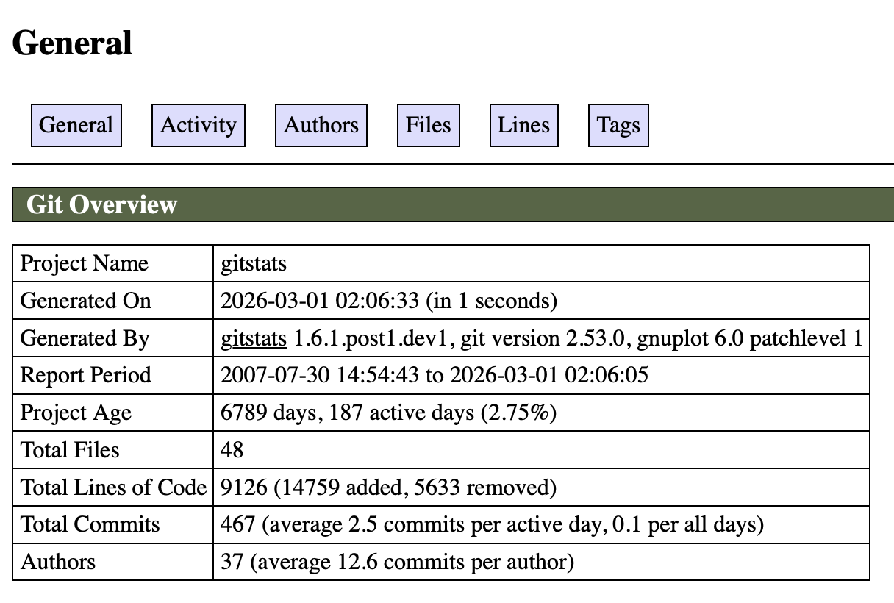
  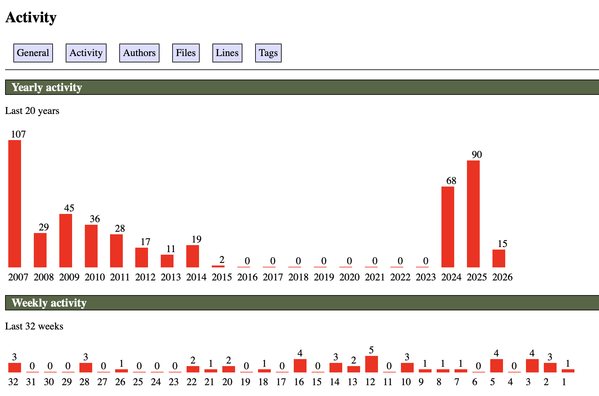
  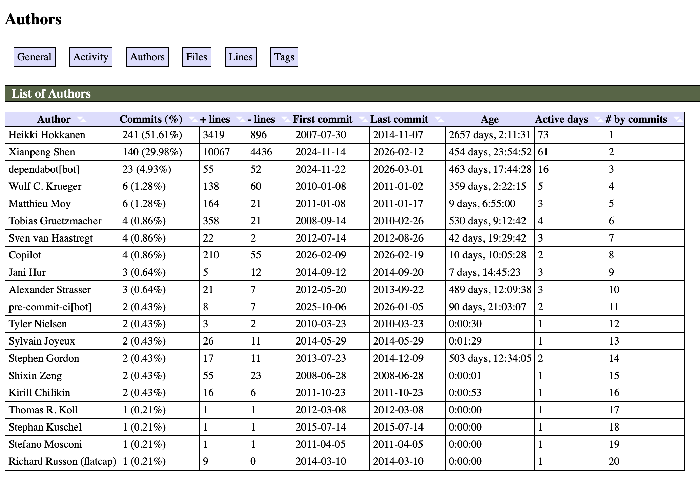
  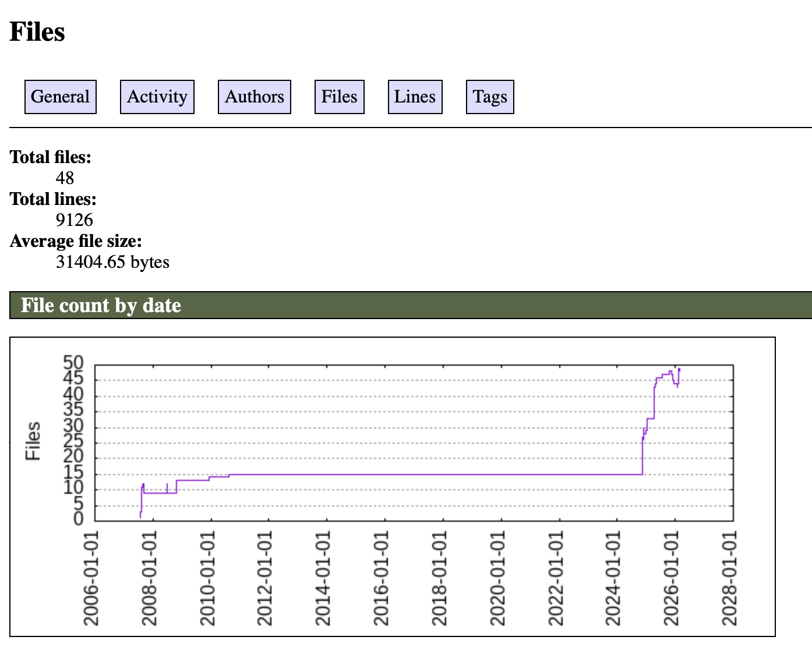
  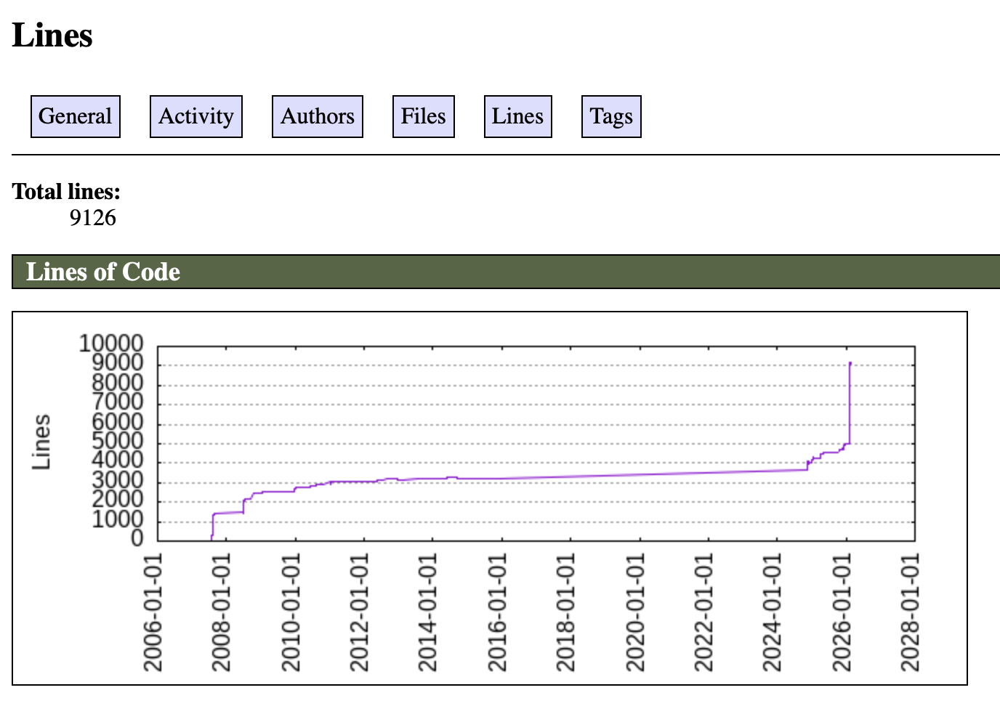
  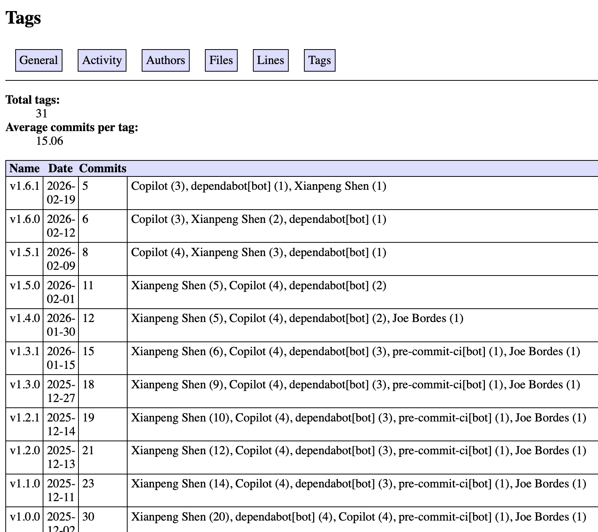


New Version:


  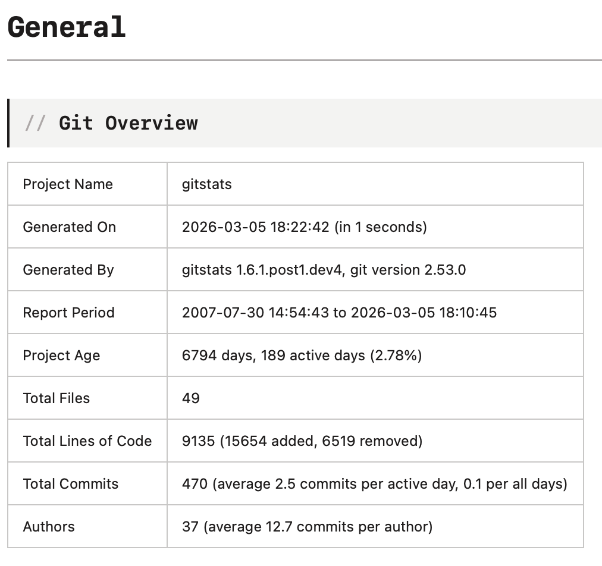
  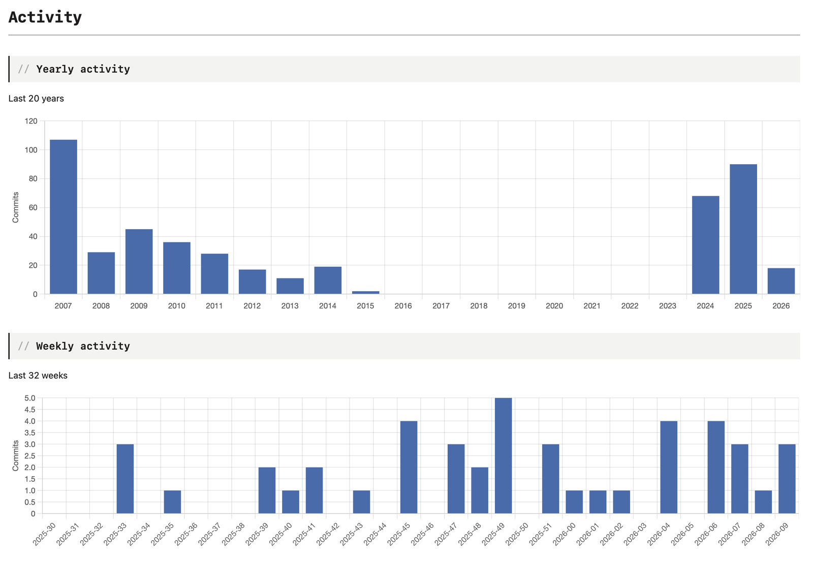
  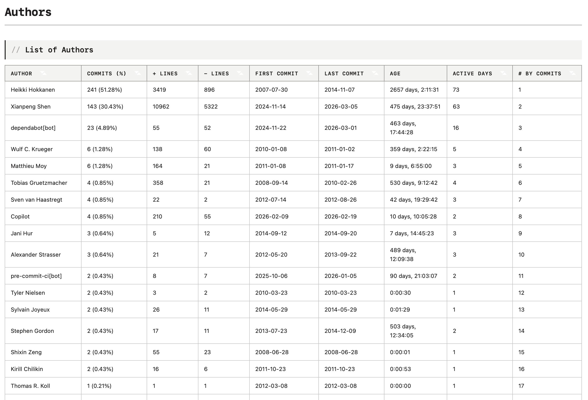
  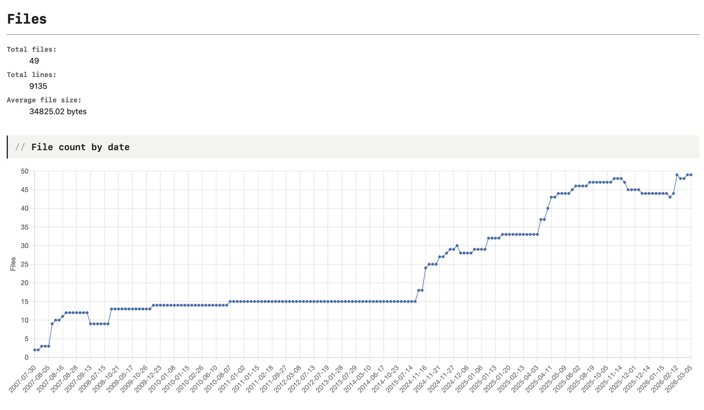
  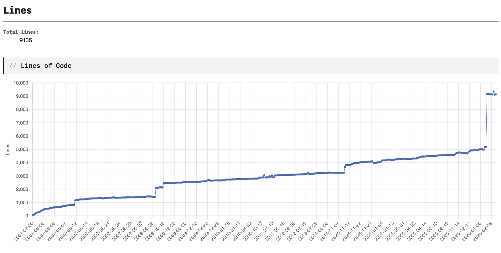
  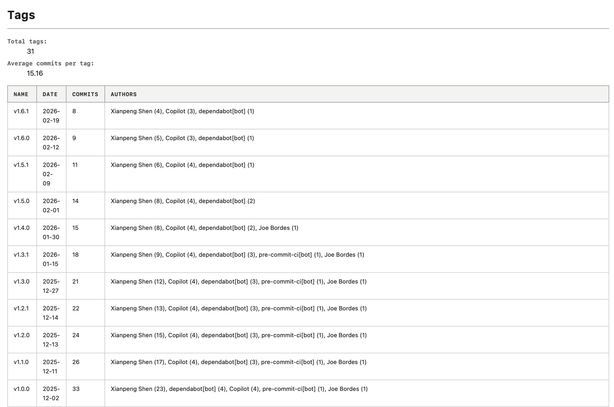


You can visit [this online preview](https://shenxianpeng.dev/gitstats/index.html) to see the actual effect, which is a report generated based on GitStats' own repository.

---

## A Few Thoughts

To be honest, I know almost nothing about UI and frontend development. This redesign was completed with Claude—I described the desired effect, it wrote the CSS, I reviewed the results, gave feedback, and then iterated. After several rounds, the outcome was much better than I expected.

The replacement of the chart engine followed the same pattern. Code changes of this magnitude, which I would most likely have put aside in the past, now feel approachable to try—this shift in mindset itself is more noteworthy than any multi-fold efficiency gain.

Maintaining an open-source project offers a peculiar experience: users don't see the time you invest, but they feel the results. There's a fundamental difference in user trust between "usable but ugly" and "usable and beautiful."

If you're using Git, why not run GitStats and see what your repository's history looks like—the stories hidden in the commit log become much clearer when presented visually with charts.

* Project Address: **https://github.com/shenxianpeng/gitstats**
* Documentation: **https://gitstats.readthedocs.io**