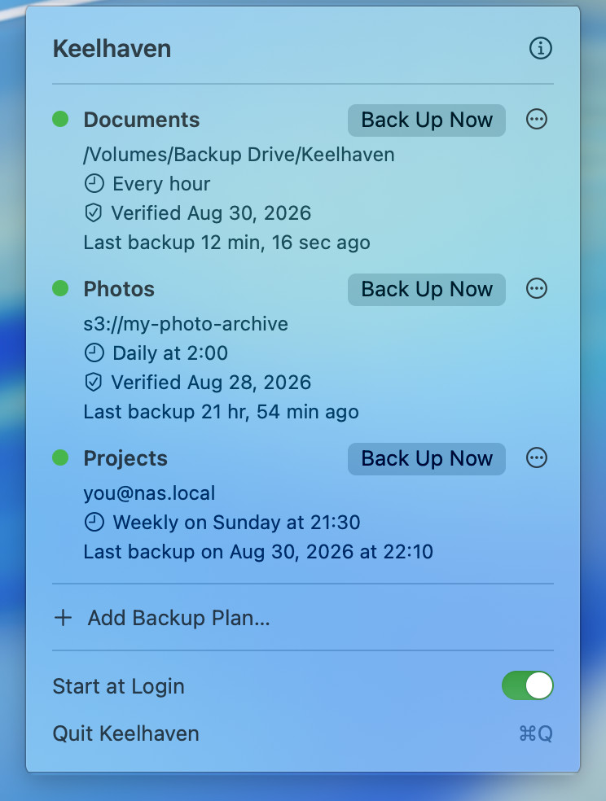
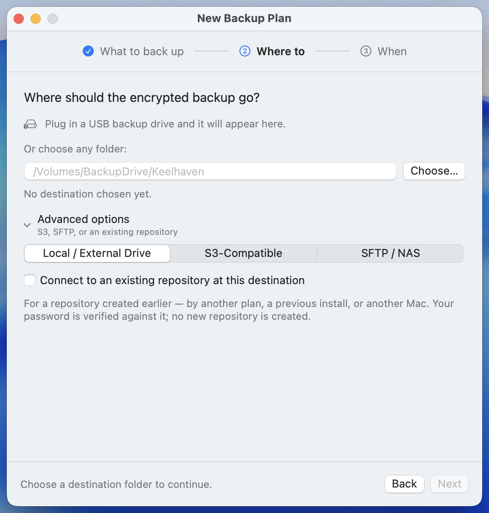

I've used restic for years. It is a very good command-line backup tool: deduplicated, encrypted and incremental, with a stable repository format and an active community.

Using it day to day, I still ran into problems.

At some point my scheduled backup job started failing quietly, and I only noticed weeks later, because nothing told me when it failed. And the repository password sat in plain text in my shell config, because the scheduled job needed it to run.

Neither of those is restic's fault. A command-line tool leaves exactly these things to you: scheduling is yours, keeping credentials safe is yours, and noticing failures is yours.

So I built [Keelhaven](https://github.com/shenxianpeng/keelhaven).

## What it is

A macOS menu bar app. No Dock icon, no main window. Pick folders, pick a destination, set how often, and then you can forget about it. It runs on schedule in the background, checks that the repository is intact, and only speaks up when something is wrong.



The destination is yours:

- **An external or portable drive.** Plug it in and pick it; the simplest option.
- **Any S3-compatible object storage.** Backblaze B2, Cloudflare R2, Wasabi, or a MinIO you run yourself.
- **SFTP.** The Synology at home, or any machine you can ssh into.



There is no account, no server of mine in the path, and no telemetry. Apart from your encrypted backups going to the destination you chose, nothing leaves your Mac.

---

## Three design decisions worth explaining

### 1. A standard restic repository, not a private format

This was the precondition for building the app, not a feature bolted on later. On any Linux machine you can list your backups with `restic snapshots -r sftp:nas:/backups/laptop`, and restoring does not need my app. If I stop working on Keelhaven one day, your data is unaffected.

The biggest risk with backup software is whether the app will still be around when you need it. A backup tool that keeps its format to itself is using its users' data as a bargaining chip.

### 2. Passwords stay off the command line and off the disk

Repository passwords and S3 keys live in the macOS Keychain, one entry per backup plan.

They reach restic only through the environment of the restic process. They never appear as command-line arguments, which any process on the Mac can read with `ps`, and they are never written to a temporary file. That environment is also kept minimal: `PATH`, `HOME`, `TMPDIR`, `SSH_AUTH_SOCK`, plus the credentials for that one run, rather than everything the app itself has.

### 3. It checks that your backups are still good

The failure that hurts in backups is the silent one: the job breaks, nobody tells you, and on the day you need it you find out it stopped three months ago.

So each plan runs `restic check` on a schedule, weekly by default, to verify the repository's integrity. The plan's row shows when it last passed. When the check passes, Keelhaven says nothing; it only notifies you when there is a problem.

---

## Not notarized by Apple yet

Joining the Apple Developer Program costs $99 a year. The project has no income at the moment, so I'm not paying that yet. The result: if you download the DMG and double-click it, macOS blocks it once.

Both scripted installs skip that prompt, because each clears the quarantine flag:

```bash
brew install --cask shenxianpeng/tap/keelhaven
curl -fsSL https://keelhaven.app/install.sh | bash
```

The Homebrew cask clears it in its `postflight` step, and the install script has a dedicated step for it. If `curl | bash` makes you uneasy, that is completely reasonable. The script is one page long, so read it first: https://keelhaven.app/install.sh

---

Keelhaven 0.5.0 is licensed under GPLv3 (the bundled restic engine itself is BSD-2-Clause). It is free, and it will stay free. It needs macOS 14 or later and runs on both Apple Silicon and Intel Macs.

Website: https://keelhaven.app
Source: https://github.com/shenxianpeng/keelhaven

Stars are welcome, and issues even more so. If you back something up with it and run into a problem, please tell me.

**Update, October 2026:** Keelhaven is now at 0.9.2. What changed after launch, most of it driven by user feedback, starts in [the 0.8.0 post](../keelhaven-0-8-0/).
