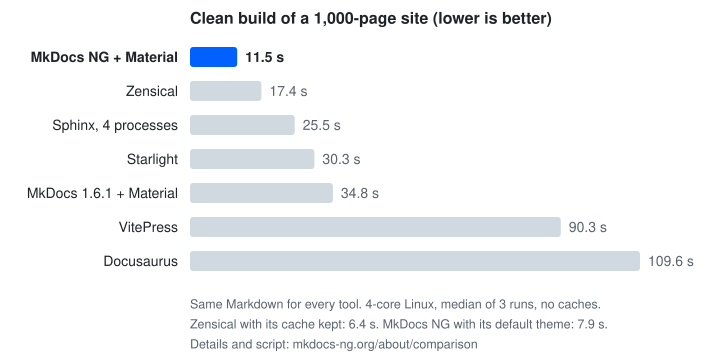
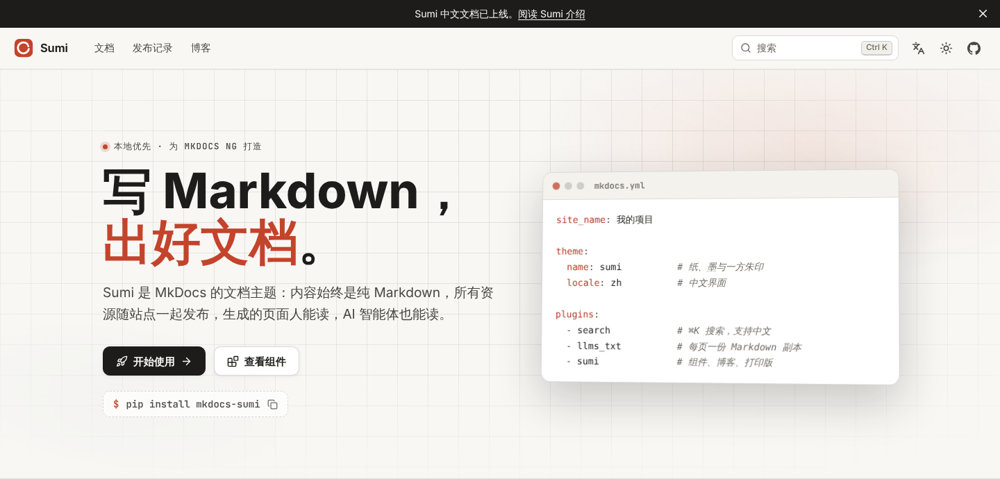

On May 13, I sent PRs to 10 MkDocs plugins in one go, all with the same change: switch the dependency from `mkdocs` to `mkdocs-ng`.

None of them were merged.

One was closed the same day, with this reply from the author:

> This plugin will work with any backwards-compatible fork without any changes, so I don't see the point in sticking to a fork with low adoption.

Fair point. MkDocs NG was two weeks old at the time. If I were a plugin author, I'd probably have said the same.

Six months later, I'm still maintaining it. On November 4, MkDocs NG 1.11.0 came out. This post is about what happened in those six months and why I keep going. (Earlier posts: [why I forked](/posts/2026/mkdocs-ng/), [v1.7.x progress](/posts/2026/mkdocs-ng-update/), [the 1.8.0 release](/posts/2026/mkdocs-ng-1.8/).)

## The original team, and the will to keep going

First, a quick look at where MkDocs stands.

The last upstream 1.x release is 1.6.1 from August 2024, and there has been no release in more than two years. Upstream's effort went into 2.0, a complete rewrite that is still a pre-release (2.0.dev6 from September 2026): no plugins, no themes, and it exits with an error when it finds a `mkdocs.yml`. Existing sites can't upgrade, and the plugin ecosystem can't follow.

The community has gone in a few directions:

- **[Zensical](https://zensical.org/)**: a new project from the team behind Material for MkDocs, with a core written in Rust, currently at 0.0.74. It reads `mkdocs.yml`, but doesn't run MkDocs plugins; it reimplements about thirty popular ones natively.
- **[ProperDocs](https://properdocs.org/)**: a fork of 1.6 started by a former MkDocs maintainer, with its own package and command name. Its last release, 1.6.7, came out in March 2026, with no release in the seven months since.

When people look at a fork, their first question is often: is it the original team?

I don't think that matters much. Original authors leave, original teams move on to new things, and that's normal. Whether a project keeps going depends on whether someone is **willing** to maintain and improve it for the long haul. Without that will, the original team stops too.

My will comes from something practical: I can't do without it. The docs sites of cpp-linter, commit-check and pipguard are all built with MkDocs. I run into what works and what gets in the way every day.

So when I took it over, I wasn't looking to reinvent it. There was one goal: **this supply chain must not break.**

I accept that point. Nobody owes a small fork a dependency change. So I turned the problem around: **if plugins won't change, MkDocs NG must not need them to.**

Since 1.10, a plugin can keep `mkdocs` in its dependencies, and once `mkdocs-ng` is installed, MkDocs NG is what runs. Some plugins used to quietly swap NG back to upstream 1.6.1, and some printed a "switch to ProperDocs" warning; both problems are gone. Later I closed the remaining open ones of those 10 PRs myself.

## The most-upvoted upstream issues: mostly cleared

Since taking over, most of my time has gone into fixing issues left behind upstream, especially the most-upvoted ones.

Sort upstream's open issues by upvotes, and of the top 15:

- **10 are fixed in MkDocs NG.** Among them the most-upvoted one, `mkdocs serve` not watching for file changes ([#4032](https://github.com/mkdocs/mkdocs/issues/4032), 70 upvotes), livereload needing an explicit flag ([#4055](https://github.com/mkdocs/mkdocs/issues/4055)), built-in themes loading from CDNs ([#2171](https://github.com/mkdocs/mkdocs/issues/2171)), no Python API for running MkDocs ([#1240](https://github.com/mkdocs/mkdocs/issues/1240)), `INHERIT` accepting only one file ([#2624](https://github.com/mkdocs/mkdocs/issues/2624)), and external links lacking `rel="external"` ([#3914](https://github.com/mkdocs/mkdocs/issues/3914)).
- **1 is much improved**: the performance and authoring experience of `mkdocs serve` ([#3695](https://github.com/mkdocs/mkdocs/issues/3695)), more on that below.
- The remaining 4: one is a joke ([#892](https://github.com/mkdocs/mkdocs/issues/892), "No beer me button"), and the other three are architectural changes (cache busting, splitting out the search plugin, decoupling themes from the core), planned for 1.12.

The full list is on [Fixed Upstream Issues](https://mkdocs-ng.org/about/fixed-upstream-issues/), which currently covers 27 upstream issues.

## 1.11.0: one mkdocs.yml for every language

1.11.0 is the first final release since 1.9.0, with no breaking changes. The biggest new feature is multi-language sites:

```yaml
# mkdocs.yml
languages:
  en: English
  zh: 中文
```

The default language goes at the site root, the others under `/zh/` and so on. Translations sit next to the original (`page.zh.md`), and untranslated pages fall back to the default language, so no link breaks. Before, you needed one `mkdocs.yml` per language stitched together with `INHERIT`; now one is enough. See [Multi-language Sites](https://mkdocs-ng.org/user-guide/multi-language-sites/).

For everything else (faster `serve`, `llms.txt`, a JSON Schema for `mkdocs.yml`, GitHub-style `> [!NOTE]` alerts and more), see the [Release Notes](https://mkdocs-ng.org/about/release-notes/).

## 79 PRs in five days

The biggest surprise of these six months was AI.

From October 31 to November 4, five days, the mkdocs-ng organization merged 79 PRs: 39 in the main repository, 19 in Sumi, 8 in the plugin catalog and 7 in Material. Four releases went out: 1.9.0, 1.10.0rc1, 1.11.0rc1 and 1.11.0. One person in their spare time couldn't have done that before.

My role is closer to a product owner: I explain the vision (what I want, what I don't, what must never break), and AI handles the implementation, tests and docs. Even the outline of this post was dictated.

The direction is still mine to set, and not every proposal gets accepted. AI once suggested adding an `mkdocs-ng` command; I said no, because users' CI scripts all say `mkdocs`, and a new command brings the migration cost right back. It also suggested having `serve` render the page being edited first; I turned that down twice and we kept to caching.

This is also why I think MkDocs NG can keep going. Zensical is a team, and a team has to eat: alongside the free, open source Zensical, they make Studio, a closed-source app with free and paid editions, and Spark, a paid membership, [to fund the team](https://zensical.org/upcoming-changes/). That's perfectly normal.

I don't have that pressure. I write code with Claude Code and hardly have to count tokens. As long as I have the will and the time, maintaining MkDocs NG is something I can just do.

## Somehow, it became the fastest

The other surprise was performance.

Among all the forks and alternatives, MkDocs NG turned out to have the fastest clean builds. Honestly, I didn't see that coming.

Looking back, it comes from keeping a close eye on performance. Since 1.8.0, every PR runs benchmarks on [CodSpeed](https://codspeed.io/), and any regression is caught before merging. On that footing we optimized bit by bit: navigation rendering is no longer O(N²), `serve` reuses unchanged pages, the search plugin reads pages three times faster.

The same 1,000 pages of Markdown, the same 4-core machine, clean builds without caches:



| Tool | Theme | Time |
| --- | --- | --- |
| MkDocs NG 1.11 | Default | 8.8 s |
| MkDocs NG 1.11 | Material | 11.1 s |
| MkDocs NG 1.11 | Sumi | 12.2 s |
| Zensical 0.0.74 | Its own (based on Material) | 15.9 s |
| MkDocs 1.6.1 | Default | 16.4 s |
| ProperDocs 1.6.7 | Default | 16.9 s |
| ProperDocs 1.6.7 | Material | 32.1 s |
| MkDocs 1.6.1 | Material | 34.2 s |

With Material, MkDocs NG takes 11.1 seconds, ProperDocs 32.1 and upstream 1.6.1 34.2: a third of the time. Without caches it is also faster than the Rust-based Zensical (15.9 seconds).

Two things to be clear about:

- Zensical has a build cache. **With its cache kept** it takes only 5.7 seconds, faster than us. MkDocs NG has no cache between builds yet.
- From editing a page in `serve` to seeing the result, Zensical and MkDocs NG (default theme) both take 1.2 seconds, a tie.

The method and script are public under [Build speed](https://mkdocs-ng.org/about/comparison/#build-speed). Feel free to run it on your own machine.

From 1.6.1 to 1.11 the language didn't change; it's still Python. All of the speed-up comes from changes like not re-rendering the navigation for every page and not recomputing pages that didn't change.

## Sumi: MkDocs NG's own theme

[Sumi](https://sumi.mkdocs-ng.org/) is the documentation theme I made for MkDocs NG. The name is Japanese for "ink": paper, ink and a vermilion seal. Its ideas are borrowed from [Oink](https://oink.pgsty.com/).



Its defining trait is that components are plain Markdown: callouts are `> [!NOTE]`, tabs are code fences with `{tab="…"}`, and your source still reads well on GitHub. Fonts, icons, search, Mermaid and KaTeX all ship with the theme, with no CDN. The MkDocs NG [website](https://mkdocs-ng.org/), Sumi's own docs and the [plugin catalog](https://catalog.mkdocs-ng.org/) are all built with it.

Trying it takes three steps:

```sh
pip install mkdocs-sumi
```

```yaml
# mkdocs.yml
theme:
  name: sumi

plugins:
  - search
  - llms_txt
  - sumi
```

```sh
mkdocs serve
```

### How is Sumi different from Material for MkDocs?

First, where Material stands. Since November 2025 it has been in maintenance mode: the upstream team moved on to Zensical, with no new features and only critical fixes. According to [Zensical's announcement](https://zensical.org/upcoming-changes/), that maintenance runs until May 5, 2027.

I forked Material into the MkDocs NG organization too. The package is `mkdocs-ng-material`, now at 9.8.0 with upstream's 9.8.0 security fixes, and its docs are at [material.mkdocs-ng.org](https://material.mkdocs-ng.org/). The theme name is still `material`, so your config doesn't change:

```sh
pip install mkdocs-ng-material
```

So both paths are open: install `mkdocs-ng-material` to keep using Material, or try Sumi.

| | Material for MkDocs | Sumi |
| --- | --- | --- |
| Status | Critical fixes only upstream; `mkdocs-ng-material` maintained in the NG organization | New theme, 0.2.x, under active development |
| Maturity | Years of work, the most features and users | Released in November 2026, still filling gaps |
| Components | Extension syntax such as `!!! note` and `=== "Tab"` | `> [!NOTE]` and `{tab="…"}`, so your source renders on GitHub too |
| External resources | Loads fonts from Google Fonts by default (can be turned off) | Fonts and icons ship with the theme, no CDN at all |
| Whole-site pages | Blog plugin built in; a landing page needs your own template | Landing page, blog, releases page and print edition built in |

For a new docs site, intranet or offline hosting, or one design for docs, landing page and blog, start with Sumi. If your site already relies heavily on Material, stay on `mkdocs-ng-material`; there's no need to switch. If you want to try Sumi, it reads most Material content as is, and switching usually means changing two lines. See [Migrating from Material](https://sumi.mkdocs-ng.org/docs/start/migrate/).

## The plugin catalog is now a website

I also turned the MkDocs plugin catalog into a website: [catalog.mkdocs-ng.org](https://catalog.mkdocs-ng.org/).

It updates itself every week, ranks projects by downloads and activity, and marks the plugins tested on MkDocs NG. It also discovers new plugins on PyPI automatically: after this week's update it will list more than 470 plugins, themes and Markdown extensions. For comparison, [mkdocs/catalog](https://github.com/mkdocs/catalog) and [ProperDocs/catalog](https://github.com/ProperDocs/catalog) list about 300 each. As far as I know, it is the most complete MkDocs plugin directory today.

If your plugin isn't there, please [open an issue](https://github.com/mkdocs-ng/catalog/issues).

## Which way to go

If your docs still run on MkDocs, my advice is: don't stay where you are.

1.6.1 still builds today, and the code is still there. But upstream no longer updates it: new Python versions, security fixes in dependencies, newly found bugs, nobody handles them. The software supply chain keeps moving. Stand still, and your code is still there, but it no longer connects to the chain. That's close to running naked on the internet, and I don't think that's an exaggeration.

Moving on, there are two paths today:

1. **MkDocs NG**: change one dependency line; plugins, config and CI stay as they are. Upstream's leftover issues are getting fixed, and clean builds are the fastest. The cost: for now it's mainly me maintaining it, running on the will I described above.
2. **Try Zensical**: it's backed by the original Material team, with income to fund the team, and its cached builds are fast. The cost: it's still at 0.0.x and doesn't run MkDocs plugins, only native rewrites of about thirty popular ones, so check that the plugins you use are among them before migrating.

I won't say much about ProperDocs. I didn't build on it because my standards for code and docs differ from its, so I forked my own. It hasn't released in more than seven months; whether it can keep going, you can judge for yourself.

Those are the trade-offs. Which way to go is your call.

## How to switch

Try it first in a throwaway environment with uv. It leaves your own environment alone:

```sh
uvx --from mkdocs-ng --with-requirements requirements.txt mkdocs build --strict
```

If that works, switching is one line, and you don't need to uninstall `mkdocs` first:

```sh
pip install -U mkdocs-ng
```

The command is still `mkdocs`, the config is still `mkdocs.yml`, and plugins and themes stay as they are. Switching back is one line too. See the [migration guide](https://mkdocs-ng.org/user-guide/migrating/).

## Finally

Six months ago I wrote that code is only the first half of a project's reach; the second half is people.

I've given the code my best this half year. Now I need your help:

- **Try Sumi and MkDocs NG** on your docs site.
- **Open an [issue](https://github.com/mkdocs-ng/mkdocs/issues)** when something breaks or you need something. The roadmap is [#59](https://github.com/mkdocs-ng/mkdocs/issues/59); tell us what you want most.
- **Contributions are welcome**: code, docs, translations, or adding a plugin you use to the [plugin catalog](https://catalog.mkdocs-ng.org/).
- If you find it useful, star [mkdocs-ng/mkdocs](https://github.com/mkdocs-ng/mkdocs) and [mkdocs-ng/mkdocs-sumi](https://github.com/mkdocs-ng/mkdocs-sumi), or share this with friends who still use MkDocs.

---

Please cite the author and source when reproducing articles from this site. Do not use for any commercial purposes. Welcome to follow my WeChat Official Account "沈显鹏".
