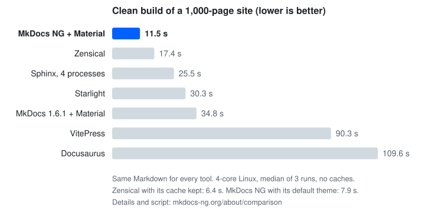
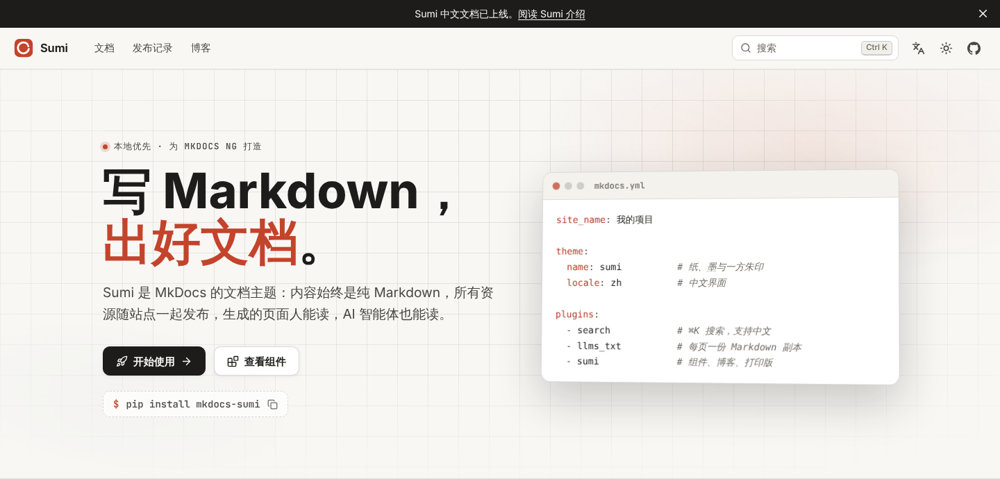

5 月 13 日，我一口气给 10 个 MkDocs 插件提了 PR，内容都一样：把依赖从 `mkdocs` 换成 `mkdocs-ng`。

一个都没合。

有一个 PR 当天就被关了，作者的回复是这样的：

> This plugin will work with any backwards-compatible fork without any changes, so I don't see the point in sticking to a fork with low adoption.

意思是：这个插件不用改，就能跑在任何向后兼容的 fork 上，看不出有什么理由去绑定一个没什么人用的 fork。

这话没错。那时候 MkDocs NG 刚发布两周，换我是插件作者，大概也会这么回。

半年过去了，我还在维护。11 月 4 日，MkDocs NG 1.11.0 发布了。这篇想聊聊这半年做了什么，以及我为什么还在做。（前面几篇在这里：[为什么 fork](/zh-cn/posts/2026/mkdocs-ng/)、[v1.7.x 进展](/zh-cn/posts/2026/mkdocs-ng-update/)、[1.8.0 发布](/zh-cn/posts/2026/mkdocs-ng-1.8/)。）

## 原班人马和愿力

先简单交代一下 MkDocs 的处境。

上游最后一个 1.x 版本是 2024 年 8 月的 1.6.1，之后两年多没有新版本。上游的精力放在了 2.0 上，但 2.0 是一次彻底的重写，目前还是预发布版（2026 年 9 月的 2.0.dev6）：没有插件、没有主题，遇到 `mkdocs.yml` 会直接报错退出。现有站点升不上去，插件生态也跟不过去。

社区里出现了几个方向：

- **[Zensical](https://zensical.org/)**：Material for MkDocs 原班团队的新项目，核心用 Rust 写，目前是 0.0.74。能读 `mkdocs.yml`，但不运行 MkDocs 插件，而是把三十个左右常用插件用原生方式重写。
- **[ProperDocs](https://properdocs.org/)**：MkDocs 前维护者发起的 1.6 fork，换了包名和命令名。最后一个版本 1.6.7 发布于 2026 年 3 月，之后七个多月没有新版本。

很多人看一个 fork，第一个问题是：是不是原班人马？

我觉得这没那么重要。原作者可以离开，原班人马也可以去做新东西，这都很正常。一个项目能不能走下去，要看有没有人**愿意**长期维护它、持续改进它。没有这份意愿，原班人马也会停下来。

我的愿力来自一个很实际的原因：我自己离不开它。cpp-linter、commit-check、pipguard 这些项目的文档站，全是 MkDocs 搭的。它哪里好用、哪里卡手，我天天都在碰。

所以接手的时候，我没想着给它变出新花样，目标就一个：**这条供应链不能断。**

那位作者的话，我是认的。没人有义务为一个小 fork 改依赖。所以我换了个思路：**既然插件不改，那就让 MkDocs NG 不需要插件改。**

1.10 起，插件依赖里写的还是 `mkdocs`，装上 `mkdocs-ng` 之后，跑起来的就是 MkDocs NG；以前装某些插件会把 NG 悄悄换回上游 1.6.1、有些插件会打印"请切换到 ProperDocs"的警告，这两个问题现在都没有了。那 10 个 PR，后来我自己关掉了剩下还开着的几个。

## 上游的高赞 Issue，基本清完了

接手以来，我花时间最多的，是修上游遗留的问题，尤其是点赞最多的那些。

把上游现在还开着的 Issue 按点赞数排序，前 15 个里：

- **10 个已经在 MkDocs NG 里修掉了**。比如点赞最多的 `mkdocs serve` 不监听文件变化（[#4032](https://github.com/mkdocs/mkdocs/issues/4032)，70 个赞）、livereload 必须手动加参数（[#4055](https://github.com/mkdocs/mkdocs/issues/4055)）、内置主题依赖 CDN（[#2171](https://github.com/mkdocs/mkdocs/issues/2171)）、没有可编程调用的 Python API（[#1240](https://github.com/mkdocs/mkdocs/issues/1240)）、`INHERIT` 只能继承一个文件（[#2624](https://github.com/mkdocs/mkdocs/issues/2624)）、外链没有 `rel="external"`（[#3914](https://github.com/mkdocs/mkdocs/issues/3914)）。
- **1 个大幅改善**：`mkdocs serve` 的性能和写作体验（[#3695](https://github.com/mkdocs/mkdocs/issues/3695)），后面会讲。
- 剩下 4 个：一个是玩笑贴（[#892](https://github.com/mkdocs/mkdocs/issues/892)，"No beer me button"），另外三个是缓存清除、搜索插件拆包、主题与核心解耦，属于架构层面的改动，排在 1.12。

完整清单在 [Fixed Upstream Issues](https://mkdocs-ng.org/about/fixed-upstream-issues/)，目前列了 27 个上游 Issue。

## 1.11.0：一个 mkdocs.yml 搞定多语言

1.11.0 是 1.9.0 之后的第一个正式版，没有破坏性变更。最大的新功能是多语言：

```yaml
# mkdocs.yml
languages:
  en: English
  zh: 中文
```

默认语言放在站点根目录，其他语言放到 `/zh/` 下面。翻译文件就放在原文旁边（`page.zh.md`），没翻译的页面自动回退到默认语言，链接不会断。以前要为每种语言写一份 `mkdocs.yml` 再用 `INHERIT` 拼起来，现在一份就够了。详见 [Multi-language Sites](https://mkdocs-ng.org/user-guide/multi-language-sites/)。

其他改动（`serve` 提速、`llms.txt`、`mkdocs.yml` 的 JSON Schema、GitHub 风格的 `> [!NOTE]` 等）见 [Release Notes](https://mkdocs-ng.org/about/release-notes/)。

## 这五天，合并了 79 个 PR

这半年最大的意外，是 AI。

从 10 月 31 日到 11 月 4 日，五天时间，mkdocs-ng 组织下合并了 79 个 PR：主仓库 39 个、Sumi 19 个、插件目录 8 个、Material 7 个。发了 1.9.0、1.10.0rc1、1.11.0rc1、1.11.0 四个版本。放在以前，一个人业余时间根本做不到。

我的角色更像产品负责人：把愿景讲清楚，要什么、不要什么、什么绝对不能破坏，剩下的实现、测试、文档交给 AI。连这篇文章的提纲，也是我口述的。

但方向还得我来定，而且不是每个方案都接。AI 提过加一个 `mkdocs-ng` 命令，我否了：用户的 CI 脚本里写的都是 `mkdocs`，命令一改，迁移成本就回来了。它还提过让 `serve` 先渲染正在编辑的那一页，我也否了两次，最后只做了缓存。

这也是我觉得 MkDocs NG 能一直做下去的原因。Zensical 是一个团队，团队要吃饭，所以在开源免费的 Zensical 之外，他们还做了闭源的 Studio（有免费版和付费版）和付费会员 Spark，[用来养活团队](https://zensical.org/upcoming-changes/)。这很正常。

我没有这个压力。我用 Claude Code 写代码，token 几乎不用算。只要我还有愿力、有时间，维护 MkDocs NG 就是顺手的事。

## 没想到，它成了最快的那一个

另一个意外是性能。

在这么多 fork 和替代品里，MkDocs NG 的干净构建竟然是最快的。说实话，这个结果我自己都没想到。

回头看，跟我一直盯着性能有关。从 1.8.0 开始，每个 PR 都会在 [CodSpeed](https://codspeed.io/) 上跑性能基准测试，有一点退化，合并前就会被揪出来。在这个前提下一点点优化：导航渲染从 O(N²) 降下来、`serve` 复用没变的页面、搜索插件读取页面快了三倍。

同一份 1000 页的 Markdown，同一台 4 核机器，各个工具做干净构建（不带缓存）：



| 工具 | 主题 | 时间 |
| --- | --- | --- |
| MkDocs NG 1.11 | 默认主题 | 8.8 秒 |
| MkDocs NG 1.11 | Material | 11.1 秒 |
| MkDocs NG 1.11 | Sumi | 12.2 秒 |
| Zensical 0.0.74 | 自带（基于 Material） | 15.9 秒 |
| MkDocs 1.6.1 | 默认主题 | 16.4 秒 |
| ProperDocs 1.6.7 | 默认主题 | 16.9 秒 |
| ProperDocs 1.6.7 | Material | 32.1 秒 |
| MkDocs 1.6.1 | Material | 34.2 秒 |

同样用 Material 主题，MkDocs NG 是 11.1 秒，ProperDocs 是 32.1 秒，上游 1.6.1 是 34.2 秒，时间只要它们的三分之一；不带缓存时，也比 Rust 写的 Zensical（15.9 秒）快。

但有两点得说清楚：

- Zensical 有构建缓存，**保留缓存时**只要 5.7 秒，比我们快。MkDocs NG 目前没有跨构建的缓存。
- `serve` 里改一个页面到看到结果，Zensical 和 MkDocs NG（默认主题）都是 1.2 秒，打平。

测试方法和脚本都公开在 [Build speed](https://mkdocs-ng.org/about/comparison/#build-speed)，欢迎在自己的机器上跑一遍。

从 1.6.1 到 1.11，语言没换，还是 Python。快出来的部分，全是导航不再每页重渲染、没变的页面不再重算这类改动。

## Sumi：MkDocs NG 自己的主题

[Sumi](https://sumi.mkdocs-ng.org/zh/) 是我为 MkDocs NG 做的文档主题，名字是日语"墨"的意思：纸、墨与一方朱印。设计理念借鉴了 [Oink](https://oink.pgsty.com/)。



它最大的特点是组件就是原生 Markdown：提示框是 `> [!NOTE]`，标签页是带 `{tab="…"}` 的代码块，源文件在 GitHub 上一样好读。字体、图标、搜索、Mermaid、KaTeX 全部随主题发布，不连任何 CDN。MkDocs NG 的[官网](https://mkdocs-ng.org/)、Sumi 自己的文档和[插件目录](https://catalog.mkdocs-ng.org/)都是用它搭的。

试一下只要三步：

```sh
pip install mkdocs-sumi
```

```yaml
# mkdocs.yml
theme:
  name: sumi
  locale: zh

plugins:
  - search
  - llms_txt
  - sumi
```

```sh
mkdocs serve
```

### Sumi 和 Material for MkDocs 有什么区别？

先说 Material 的现状。从 2025 年 11 月起，它进入了维护模式，上游团队转去做 Zensical，不再开发新功能，只做关键修复。按 [Zensical 官网的说明](https://zensical.org/upcoming-changes/)，这种维护会持续到 2027 年 5 月 5 日。

我把 Material 也 fork 到了 MkDocs NG 组织下，包名 `mkdocs-ng-material`，现在是 9.8.0，同步了上游 9.8.0 的安全修复，文档在 [material.mkdocs-ng.org](https://material.mkdocs-ng.org/)。主题名还是 `material`，配置一行都不用改：

```sh
pip install mkdocs-ng-material
```

所以两条路都在：想继续用 Material，就装 `mkdocs-ng-material`；想试新东西，就用 Sumi。

| | Material for MkDocs | Sumi |
| --- | --- | --- |
| 状态 | 上游只做关键修复；`mkdocs-ng-material` 在 NG 组织下继续维护 | 新主题，0.2.x，还在持续开发 |
| 成熟度 | 多年积累，功能和用户都最多 | 2026 年 11 月才发布，功能还在补 |
| 组件写法 | `!!! note`、`=== "Tab"` 这类扩展语法 | `> [!NOTE]`、`{tab="…"}`，源文件在 GitHub 上也能正常显示 |
| 外部资源 | 默认从 Google Fonts 加载字体，可以关掉 | 字体、图标全部随主题发布，不连任何 CDN |
| 整站页面 | 自带博客插件，首页要自己写模板 | 首页、博客、发布页、打印版都内置 |

新建的文档站、内网或离线部署、想用一套设计把文档首页博客放一起，可以从 Sumi 开始。已经深度用了 Material 的站点，继续用 `mkdocs-ng-material` 就好，没必要折腾。想试的话，大部分 Material 内容 Sumi 能直接读，切换通常只改两行，见[从 Material 迁移](https://sumi.mkdocs-ng.org/zh/docs/start/migrate/)。

## 插件目录做成了网站

这次还把 MkDocs 的插件目录做成了网站：[catalog.mkdocs-ng.org](https://catalog.mkdocs-ng.org/)。

它每周自动更新，按下载量和活跃度排序，在 MkDocs NG 上测过的插件会单独标出来。它还会自动从 PyPI 发现新插件，这周的更新之后会收录 470 多个插件、主题和 Markdown 扩展。作为对比，[mkdocs/catalog](https://github.com/mkdocs/catalog) 和 [ProperDocs/catalog](https://github.com/ProperDocs/catalog) 目前各 300 个左右。据我所知，这是现在最全的 MkDocs 插件目录。

你的插件不在里面的话，欢迎[提 Issue](https://github.com/mkdocs-ng/catalog/issues)。

## 该怎么选

如果你的文档还在用 MkDocs，我的建议是：别待在原地。

1.6.1 今天照样能构建，代码也还在。但上游不再更新，新的 Python 版本、依赖的安全修复、新冒出来的 bug，都没人管了。软件供应链一直在往前走，你停在原地，代码虽然还在，供应链却已经接不上了。这跟在互联网上裸奔差不多，一点都不夸张。

往前走，现在有两条路：

1. **MkDocs NG**：改一行依赖，插件、配置、CI 都不用动；上游遗留的问题在修，干净构建也是最快的。代价是目前主要是我一个人在维护，靠的就是前面说的愿力。
2. **试试 Zensical**：背后是 Material 原班团队，有收入养团队，带缓存的构建很快。代价是它还在 0.0.x，不运行 MkDocs 插件，只原生重写了三十个左右常用的，迁移前要先确认你用的插件在不在里面。

ProperDocs 我就不多说了。当初我没在它的基础上做，是因为我对代码和文档的要求跟它不太一样，所以自己 fork 了一个。它现在七个多月没发版，后面能不能维持下去，大家自己判断。

利弊就这些，选哪条你自己定。

## 怎么切过来

先用 uv 在临时环境里试一下，不会动你现有的环境：

```sh
uvx --from mkdocs-ng --with-requirements requirements.txt mkdocs build --strict
```

没问题的话，正式切换只要一行，不需要先卸载 `mkdocs`：

```sh
pip install -U mkdocs-ng
```

命令还是 `mkdocs`，配置还是 `mkdocs.yml`，插件和主题都不用改。想切回去，也是一行。详见[迁移指南](https://mkdocs-ng.org/user-guide/migrating/)。

## 最后

半年前我说过：一个项目有没有影响力，代码只是前半段，后半段是人。

代码这半年我尽力了，接下来需要你的帮忙：

- **试一试 Sumi 和 MkDocs NG**，把你的文档站跑起来看看。
- **遇到问题、有需求，就去提 [Issue](https://github.com/mkdocs-ng/mkdocs/issues)**。路线图在 [#59](https://github.com/mkdocs-ng/mkdocs/issues/59)，欢迎留言说说你最想要什么。
- **欢迎贡献**，代码、文档、翻译都行，或者在[插件目录](https://catalog.mkdocs-ng.org/)里补一个你常用的插件。
- 觉得有用的话，给 [mkdocs-ng/mkdocs](https://github.com/mkdocs-ng/mkdocs) 和 [mkdocs-ng/mkdocs-sumi](https://github.com/mkdocs-ng/mkdocs-sumi) 点个 Star，或者转给身边还在用 MkDocs 的朋友。

---

转载本站文章请注明作者和出处，请勿用于任何商业用途。欢迎关注公众号「沈显鹏」
