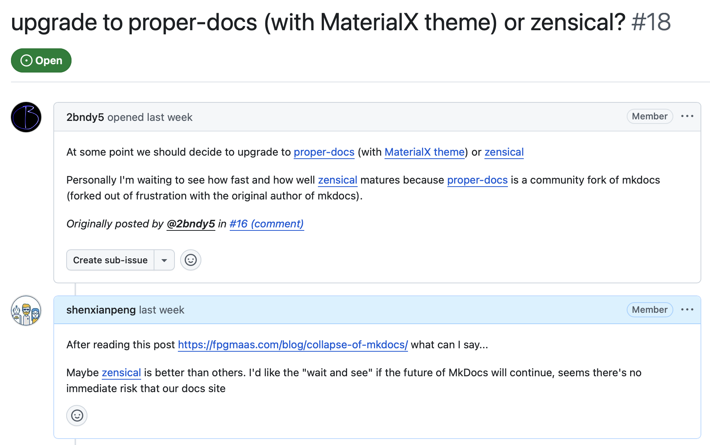

Last week I created a new GitHub organization, [MkDocs NG][mkdocs-ng-org], and published two packages to PyPI:

- [`mkdocs-ng`][mkdocs-ng-pypi]
- [`mkdocs-ng-material`][mkdocs-ng-material-pypi]

In short: I forked MkDocs and Material for MkDocs, and I'm maintaining them. This post covers why, and what is done so far.

## Why MkDocs

Of all the documentation tools used in open source, MkDocs with Material for MkDocs has long been my favorite pairing.

You write Markdown, configure in YAML, extend with plugins, get a theme that looks good, and deploy with very little effort. The documentation for many of my own projects is built with it. For an open-source docs site, it covers nearly everything I need.

Both projects are in poor shape, though. MkDocs has not had a release since 1.6.1 in August 2024. Material for MkDocs entered maintenance mode in November 2025.

The question came up again when a fellow cpp-linter maintainer opened [an issue on our docs site][cpp-linter-18]: should we move to ProperDocs with the MaterialX theme, or to Zensical? Zensical is the new project from squidfunk's team, the people behind Material for MkDocs, and it is where they are heading next.



I looked around and read Florian Maas's [The Slow Collapse of MkDocs][collapse-article], which lays out the last few years of MkDocs maintenance in detail. Roughly: the original author was absent for a long time and community maintainers kept the project running. Then the maintainers disagreed, the original author came back, and the focus moved to a MkDocs 2.0 rewrite that does not work with the existing plugin ecosystem. MkDocs 1.x maintenance stalled, Material for MkDocs went into maintenance mode, and the community split across replacements: ProperDocs, MaterialX, Zensical.

The real story has far more detail than that, and the article is worth reading in full.

For me the conclusion was simple. I still like MkDocs and Material for MkDocs, and I want them to keep being maintained.

If I had to pick a replacement, I would probably try Zensical. It is not mature yet, though, and its ecosystem is still forming. So the realistic move was not to migrate right away. It was to keep maintaining the tools a large number of projects already depend on.

No replacement satisfied me, so I decided to maintain them myself. That is MkDocs NG, where NG stands for Next Generation.

## What I've done so far

Over a weekend I forked both projects into the MkDocs NG organization:

- `mkdocs/mkdocs` → [`mkdocs-ng/mkdocs`][mkdocs-repo]
- `squidfunk/mkdocs-material` → [`mkdocs-ng/mkdocs-material`][mkdocs-material-repo]

Two projects that have always been used together are now maintained in one place.

Then I started on the most urgent work: fixing bugs, upgrading dependencies, supporting newer Python versions, and shipping releases. Progress so far:

- `mkdocs-ng` went from 1.7.0 to 1.7.2, three releases in three days.
- `mkdocs-ng-material` has been rebranded, its docs updated, and its Docker image moved to GitHub Container Registry (`ghcr.io/mkdocs-ng/mkdocs-material`). Its first release, 9.7.7, is out.

Switching means changing two lines in your requirements:

```diff
- mkdocs
- mkdocs-material
+ mkdocs-ng
+ mkdocs-ng-material
```

`mkdocs-ng-material` depends on `mkdocs-ng`, so replace both together. In an existing virtual environment, uninstall the old packages first, because the new ones install the same `mkdocs` module:

```bash
pip uninstall mkdocs mkdocs-material
pip install mkdocs-ng mkdocs-ng-material
```

The command is still `mkdocs`, the configuration file is still `mkdocs.yml`, and plugin and theme names are unchanged. In most cases the package name is the only thing you touch, and the rest of your MkDocs workflow keeps working.

## Why not one of the other forks?

I have seen the other community forks, ProperDocs among them.

I'm not going to rank them. Everyone in open source has different goals, different trade-offs and a different way of maintaining a project.

My own needs were specific: keep the MkDocs and Material for MkDocs experience as it is, keep the cost of migrating close to zero, and keep fixing bugs, upgrading dependencies and shipping releases. That pointed to a fork I maintain myself.

I don't want to split the community for no reason, though. I said as much in [MkDocs Discussion #4010][discussion-4010]: if the upstream maintainers are willing to add me to the team, I'm happy to do this work in upstream directly. For users, that would be the best outcome.

Until then, I'll keep MkDocs NG going.

## Where I need help

What I can do is clear: fix bugs, upgrade dependencies, support new versions, ship releases.

After a few years of open source, though, I've come to see code as only the first half of what makes a project matter. The second half is people: how many know it exists, how many are willing to try it, how many mention it to someone else. That decides whether a project keeps going.

If you use MkDocs or Material for MkDocs, any of these helps:

1. Swap `mkdocs` for `mkdocs-ng` and `mkdocs-material` for `mkdocs-ng-material`, and try the new releases.
2. When something breaks, [open an issue][mkdocs-issues]. I'll reply quickly and fix what I can.
3. Star the repositories. Not for vanity: more stars means more people find them, and more people are willing to try them.
4. If people around you use MkDocs, forward this to them.
5. If your company's docs run on MkDocs, you can also [sponsor the work][sponsors].

I can keep the code maintained on my own. Getting the word out takes more than one person.

The two repositories:

- [mkdocs-ng/mkdocs][mkdocs-repo]
- [mkdocs-ng/mkdocs-material][mkdocs-material-repo]

Thank you.

---

**Update, October 2026:** `mkdocs-ng` has since shipped 1.7.3 and 1.8.0, its first feature release. The details are in the next two posts in this series: [the 1.7.x summary](../mkdocs-ng-update/) and [1.8.0](../mkdocs-ng-1.8/).

[mkdocs-ng-org]: https://github.com/mkdocs-ng
[mkdocs-ng-pypi]: https://pypi.org/project/mkdocs-ng/
[mkdocs-ng-material-pypi]: https://pypi.org/project/mkdocs-ng-material/
[cpp-linter-18]: https://github.com/cpp-linter/cpp-linter.github.io/issues/18
[collapse-article]: https://fpgmaas.com/blog/collapse-of-mkdocs/
[discussion-4010]: https://github.com/mkdocs/mkdocs/discussions/4010
[mkdocs-repo]: https://github.com/mkdocs-ng/mkdocs
[mkdocs-material-repo]: https://github.com/mkdocs-ng/mkdocs-material
[mkdocs-issues]: https://github.com/mkdocs-ng/mkdocs/issues
[sponsors]: https://github.com/sponsors/shenxianpeng
