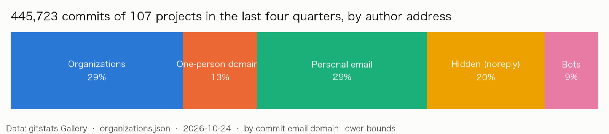
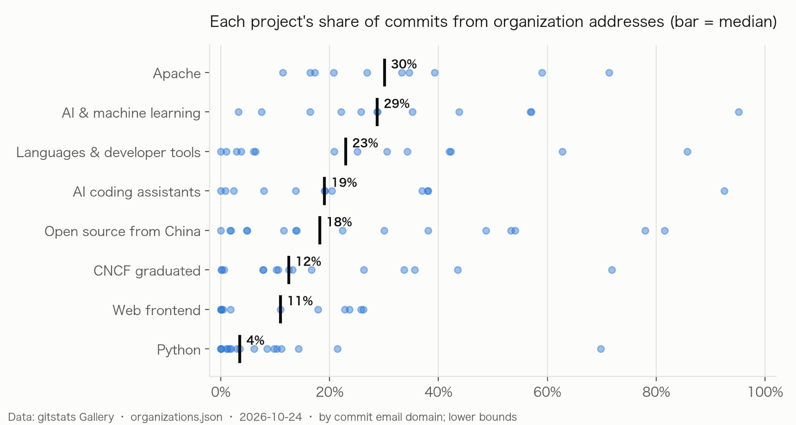
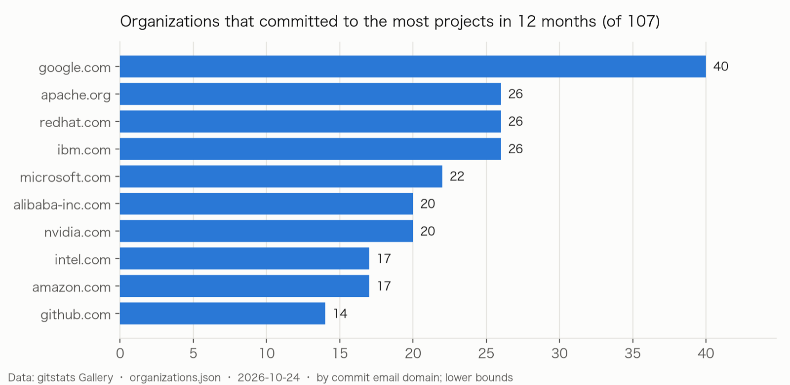

> gitstats monthly note · October 2026 · data: 2025 Q4 to 2026 Q3

## The short version

**Of the 446,000 commits made to 107 large open-source projects in the last year, 29% came from organization addresses. But projects differ widely: the median project is at 16%. Projects run by a company are close to 100%; community projects such as Flask, Requests and FastAPI are close to 0. Google reaches furthest: it committed to 40 of the projects in 12 months.**

Every commit carries its author's email address, and a domain such as `@google.com` or `@redhat.com` says roughly which organization the address belongs to. [gitstats](https://github.com/shenxianpeng/gitstats) counts commits by that domain. Mail anyone can sign up for (`gmail.com`, `qq.com`) counts as personal; the private `noreply` addresses of GitHub and GitCode count as hidden; and a domain only one person commits from (`@jane.dev`) is a one-person domain, not an organization.

## 1. Company projects and community projects are two different worlds

The highest shares belong almost entirely to projects a company runs:

| Project | From organizations | Mainly |
|---|---:|---|
| JAX | 95% | google.com |
| Codex CLI | 93% | openai.com |
| nginx | 86% | nginx.com, f5.com |
| Apache Doris | 82% | selectdb.com |
| Cilium | 72% | isovalent.com |

At the other end, Flask, Requests and Tailwind CSS are at 0%, and FastAPI, Neovim and webpack below 0.1%.

By ecosystem, **Python's median is 3.5%**, the lowest of the eight: NumPy 3.5%, Django 3.0%, pandas 1.6%, pip 1.2%. Most of their commits come from personal addresses: 79% of NumPy's, 84% of pip's. The highest medians are Apache (30%) and AI & machine learning (29%).

## 2. The most commits and the widest reach are not the same thing

google.com made the most commits in the last 12 months (21,933) and also reached the most projects: **40**, from TensorFlow, Kubernetes and Go to Git, curl and CPython. Next come redhat.com and ibm.com (26 projects each) and microsoft.com (22).

openai.com, second by commits (10,170), made nearly all of them in its own Codex CLI; kilocode.ai, third, made all of its in its own Kilo Code. **How many other people's projects an organization shows up in** says more about what it puts into open source than its commit count does.

## 3. A fifth of the commits don't say where they come from

**20% of the commits use a code host's hidden address.** TypeScript is the clearest case: a project Microsoft leads, yet 61% of its commits use hidden addresses, and only 11% can be put down to an organization by domain (almost all microsoft.com). webpack (71%), Pydantic (56%) and Transformers (53%) look the same.

So every organization share here is a **lower bound**: what organizations put in can only be more than the numbers show.

## Method and limits

1. **A domain says where an address is, not who pays.** People commit from personal addresses on paid time, and from work addresses on their own.
2. **Foundation and project domains count as organizations.** Apache committers often use `apache.org` addresses; `python.org` and `golang.org` are the same. That is part of why Apache has the highest median.
3. **One-person domains are not always caught.** A person who used two names over the years can make their own domain look like an organization.
4. **Bots are found by rules.** The first count took OpenHarmony's CI account (a GitCode private address) and the bot that exports Google's internal changes into TensorFlow for organizations; [gitstats#348](https://github.com/shenxianpeng/gitstats/pull/348) fixed that, and this note uses the corrected data.
5. **The sample is the Gallery's 107 projects**, which lean towards large, well-known ones; it is not all of open source.
6. **Windows:** shares are of the last four complete quarters (2025 Q4 to 2026 Q3); an organization's commits are those of the 12 months up to each project's last commit.

## Look up an organization

- Every organization, and where each project's commits come from: [Gallery · Organizations](https://shenxianpeng.dev/gitstats/gallery/organizations.html)
- Each organization has a page and a badge, for example [google.com](https://shenxianpeng.dev/gitstats/gallery/orgs/google.com.html)
- Data: [organizations.json](https://shenxianpeng.dev/gitstats/gallery/organizations.json), [organizations.csv](https://shenxianpeng.dev/gitstats/gallery/organizations.csv)
- The same report for your own project: `pip install gitstats && gitstats .`
