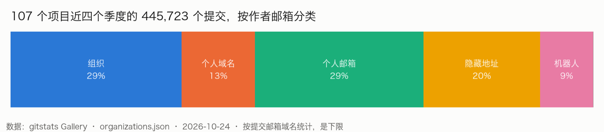
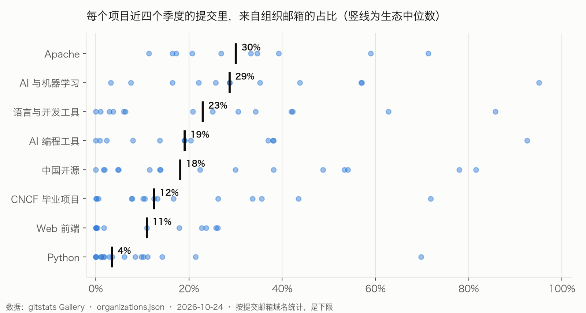
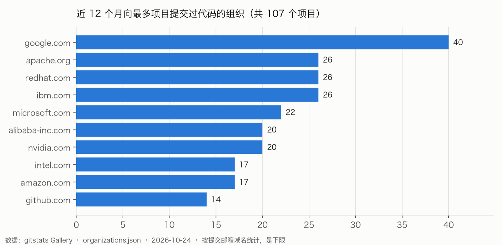

> gitstats 月度短文 · 2026 年 10 月 · 数据：2025 Q4 至 2026 Q3 · 作者：shenxianpeng

## 一句话结论

**在 107 个大型开源项目近一年的 44.6 万个提交里，29% 来自组织邮箱，但项目之间差得很远：中位数项目只有 16%。公司自己的项目接近 100%，Flask、Requests、FastAPI 这类社区项目接近 0。Google 是覆盖面最广的组织，一年里向 40 个项目提交过代码。**

每个提交都带着作者的邮箱。`@google.com`、`@redhat.com` 这样的域名，大致说明了这个地址属于哪个组织。[gitstats](https://github.com/shenxianpeng/gitstats) 按域名把提交归到组织下：`gmail.com`、`qq.com` 这类谁都能注册的邮箱算个人邮箱；GitHub、GitCode 的 `noreply` 隐私地址算隐藏地址；只有一个人在用的域名（比如 `@jane.dev`）单独算作个人域名，不算组织。

## 发现一：公司项目和社区项目，是两个世界

组织占比最高的，几乎都是公司自己主导的项目：

| 项目 | 组织占比 | 主要组织 |
|---|---:|---|
| JAX | 95% | google.com |
| Codex CLI | 93% | openai.com |
| nginx | 86% | nginx.com、f5.com |
| Apache Doris | 82% | selectdb.com |
| Cilium | 72% | isovalent.com |

另一头，Flask、Requests、Tailwind CSS 是 0%，FastAPI、Neovim、webpack 不到 0.1%。

按生态看，**Python 生态的中位数只有 3.5%**，是 8 个生态里最低的：NumPy 3.5%、Django 3.0%、pandas 1.6%、pip 1.2%。在这些项目里，大部分提交来自个人邮箱，NumPy 是 79%，pip 是 84%。中位数最高的是 Apache（30%）和 AI 与机器学习（29%）。

## 发现二：提交最多和覆盖最广，是两回事

近 12 个月提交数最多的组织是 google.com（21,933 个），覆盖面也最广：**40 个项目**，从 TensorFlow、Kubernetes、Go，到 Git、curl、CPython。之后是 redhat.com、ibm.com（各 26 个项目）和 microsoft.com（22 个）。

提交数排第二的 openai.com（10,170 个），绝大部分来自它自己的 Codex CLI；排第三的 kilocode.ai，全部来自它自己的 Kilo Code。提交多不代表参与面广，**一个组织在多少个别人的项目里出现**，更能说明它对开源生态的投入。

## 发现三：五分之一的提交，看不出来自哪里

107 个项目的提交里，**20% 用的是 GitHub 等平台的隐藏地址**。最典型的是 TypeScript：这是微软主导的项目，但 61% 的提交用的是隐藏地址，按域名能归到组织的只有 11%（几乎都是 microsoft.com）。webpack（71%）、Pydantic（56%）、Transformers（53%）也是这样。

所以这篇文章里的组织占比都是**下限**，组织的实际投入只会比数字显示的更多。

## 方法与局限

1. **域名说明地址属于哪里，不说明谁付的工资。** 有人用个人邮箱在上班时间写代码，也有人用公司邮箱在业余时间写。
2. **基金会和项目自己的域名也算作组织。** Apache 项目的提交者常用 `apache.org` 地址，`python.org`、`golang.org` 也是这样。Apache 生态的中位数排第一，部分是这个原因。
3. **个人域名的识别不完美。** 同一个人前后用过两个名字时，他的个人域名会被误算成组织。
4. **机器人的识别靠规则。** 首次统计时，OpenHarmony 的 CI 账号（GitCode 隐私地址）和 TensorFlow 从 Google 内部同步代码的机器人被算成了组织，已在 [gitstats#348](https://github.com/shenxianpeng/gitstats/pull/348) 修正，本文数据是修正后的结果。
5. **样本是 Gallery 的 107 个项目**，偏向大型、知名的项目，不代表整个开源世界。
6. **时间窗口**：比例按近四个完整季度（2025 Q4 至 2026 Q3）计算；组织的提交数按每个项目最后一次提交之前的 12 个月计算。

## 看看你关心的组织

- 全部组织的排行和每个项目的来源构成：[Gallery · Organizations](https://shenxianpeng.dev/gitstats/gallery/organizations.html)
- 每个组织都有自己的页面和徽章，例如 [google.com](https://shenxianpeng.dev/gitstats/gallery/orgs/google.com.html)
- 数据下载：[organizations.json](https://shenxianpeng.dev/gitstats/gallery/organizations.json)、[organizations.csv](https://shenxianpeng.dev/gitstats/gallery/organizations.csv)
- 给自己的项目生成同样的报告：`pip install gitstats && gitstats .`

---

转载本站文章请注明作者和出处，请勿用于任何商业用途。欢迎关注公众号「沈显鹏」
